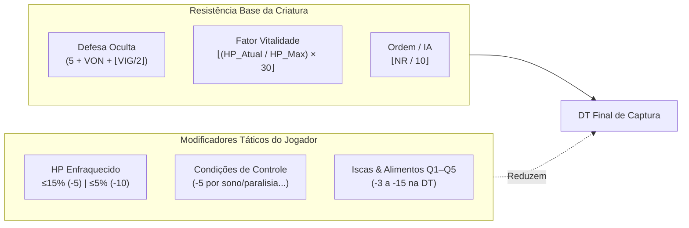

# 🐾 Compêndio de Doma, Captura e Bestas de Carga: Estilo Pokémon

> **Versão Canônica:** 1.0  
> **Módulos no Motor Java:** [`SistemaDoma.java`](file:///c:/Users/Usuário/Desktop/codigos/rpg/src/personagem/SistemaDoma.java), [`Monstro.java`](file:///c:/Users/Usuário/Desktop/codigos/rpg/src/personagem/Monstro.java), [`Ficha.java`](file:///c:/Users/Usuário/Desktop/codigos/rpg/src/personagem/Ficha.java)  
> **Persistência Relacional:** SQLite (`thaluria.db`) $\rightarrow$ tabela `ficha_monstros_domados` via [`FichaDAO.java`](file:///c:/Users/Usuário/Desktop/codigos/rpg/src/persistencia/FichaDAO.java)  
> **Suíte de Testes Automatizados:** [`TesteSistemaDoma.java`](file:///c:/Users/Usuário/Desktop/codigos/rpg/src/teste/TesteSistemaDoma.java) (44/44 testes aprovados)

---

## 🧭 1. Visão Geral e Filosofia Canônica

O **Sistema de Doma de Thaluria** foi concebido como uma mecânica tática, profunda e viva inspirada na lógica clássica de captura estilo *Pokémon*, porém integrada à física realista e às regras canônicas de atributos de Thaluria RPG:

1. **Fidelidade Ontológica (Sem Mutação de Classe):**
   * O monstro capturado **não sofre metamorfose nem troca de classe**. Ele permanece sendo uma instância autêntica de `Monstro.java`, preservando suas características biológicas, atributos, porte anatômico e lista de `HabilidadeCombate.java` inatas.
   * Ao ser capturado, a própria instância é vinculada à lista `monstrosDomados` da [`Ficha.java`](file:///c:/Users/Usuário/Desktop/codigos/rpg/src/personagem/Ficha.java) do jogador, com a referência `setDono(ficha)` e o marcador `setDomado(true)`.

2. **Doma Orgânica por Mérito Tático:**
   * Nenhum monstro é capturado apenas pela força bruta: a Dificuldade do Teste (DT) é drasticamente reduzida conforme os jogadores enfraquecem o monstro, aplicam efeitos de controle (sono, paralisia, congelamento) e oferecem insumos alimentares de alta gastronomia/alquimia.

3. **Dupla Função: Combate e Logística Pesada:**
   * **No Combate:** O treinador pode gastar ações táticas para comandar o monstro a desferir suas habilidades inatas.
   * **Na Logística:** Monstros de grande porte funcionam como **Bestas de Carga Colossais**, ampliando a capacidade de peso do grupo pela sua Força muscular ($\text{FOR} \times 10\text{ kg}$) e desbloqueando o transporte de itens de volumetria [`TamanhoItem.COLOSSAL`](file:///c:/Users/Usuário/Desktop/codigos/rpg/src/economia/TamanhoItem.java) ($25.0+$ slots, como crânios de dragão e bigornas ancestrais) sem exigir carroça ou caravana.

---

## 🐾 2. Anatomia de um Monstro (`Monstro.java`)

Cada criatura selvagem ou domesticável é representada pelos 6 atributos canônicos de Thaluria e um conjunto de atributos derivados:

```
Monstro
 ├── Identidade: id, nome, especie, porte (PorteMonstro)
 ├── Atributos Físicos: Vigor (VIG), Força (FOR), Destreza (DES)
 ├── Atributos Etéreos: Mental (MEN), Espírito (ESP), Vontade (VON)
 ├── Recursos Vitais: HP Atual / HP Máximo
 ├── Parâmetros de Poder: PA (Poder Ativo), NR (Nível de Ressonância), Ordem (IA)
 ├── Resistência Psíquica: Defesa Oculta (5 + VON + ⌊VIG / 2⌋)
 ├── Aptidão de Doma: domesticavel (boolean), domado (boolean), dono (Ficha)
 ├── Arsenal Inato: List<HabilidadeCombate>
 └── Condições Ativas: List<EfeitoItem> (Paralisia, Sono, Congelamento...)
```

### Escala de Portes Anatômicos (`PorteMonstro`)

| Porte | Multiplicador de Espaço | Bônus de Slots de Mochila | Besta de Carga Colossal? | Exemplos Canônicos |
|---|:---:|:---:|:---:|---|
| `MINUSCULO` | $0.25\times$ | $+0$ | ❌ Não | Fadas silvestres, corvos mensageiros |
| `PEQUENO` | $0.50\times$ | $+0$ | ❌ Não | Kobolds, raposas árticas |
| `MEDIO` | $1.00\times$ | $+15$ | ❌ Não | Lobos das Neves, javalis da floresta |
| **`GRANDE`** | $2.00\times$ | **$+50$** | **✅ Sim** | Grifos do Alto Vale, ursos-polares, cavalos de guerra |
| **`COLOSSAL`** | $4.00\times$ | **$+150$** | **✅ Sim** | Behemoths Ancestrais, Mamutes de Guerra, Hidras |

---

## 🎯 3. O Teste de Captura via Perícia Adestramento (ESP)

A captura é resolvida por um teste ativo da perícia canônica **Adestramento**, atrelada ao atributo **Espírito (ESP)** do jogador:

### 3.1. Pré-Requisitos Rígidos de Doma
Para que uma tentativa de captura seja iniciada, duas condições de contorno são obrigatórias:
1. `domesticavel == true`: A espécie deve ter predisposição biológica ou comportamental para domesticação. Entidades lendárias ou monstros de cólera inata (ex: Dragão Vermelho Ancião) possuem `domesticavel == false` e rejeitam qualquer teste.
2. `monstro.isVivo() == true (HP > 0)`: Não é permitido adestrar carcaças abatidas.

> [!WARNING]
> Se o monstro for indomável (`domesticavel == false`) ou estiver morto (`HP <= 0`), a tentativa é sumariamente rejeitada como **inválida**, sem rolagem de dados e sem desperdício de iscas.

### 3.2. Regra da Rolagem de Adestramento
A resolução segue rigorosamente a mecânica d20 canônica do Thaluria RPG:

$$\text{Rolagem de Adestramento} = \begin{cases} 
\max(d_1, d_2, \dots, d_{\text{Grau}}) + (\text{Maestria} \times 5), & \text{se } \text{Grau} \ge 1 \\
\min(d_1, d_2), & \text{se } \text{Grau} = 0 \text{ (Rola 2d20, pior resultado)}
\end{cases}$$

* **Grau 0 (Leigo):** O personagem não possui treinamento em Adestramento. Ele rola $2d20$ e é obrigado a ficar com o **menor** número.
* **Grau 1+ (Treinado):** Rola tantos dados $d20$ quanto o Grau na perícia (limitado pelo $\text{Grau}_{\text{ESP}} = \lfloor \text{ESP} / 10 \rfloor$), escolhe o maior e soma $+5$ por nível de Maestria (até $+15$ com Maestria 3).

---

## 🧮 4. Cálculo da DT de Captura (Estilo Pokémon)

A Dificuldade do Teste (DT) representa a força de vontade do monstro em resistir ao adestramento:

$$\bbox[12px,border:2px solid #5c7cfa,background:#1e1f29]{\mathbf{DT}_{\text{Final}} = \mathbf{Defesa Oculta} + \mathbf{Fator Vitalidade} + \mathbf{Ordem} - \mathbf{Bônus}_{\text{HP}} - \mathbf{Redutor}_{\text{Condições}} - \mathbf{Redutor}_{\text{Isca}}}$$



### Componentes da Equação:

1. **Defesa Oculta (Base de Vontade e Vigor):**
   $$\text{Defesa Oculta} = 5 + \text{VON} + \left\lfloor \frac{\text{VIG}}{2} \right\rfloor$$
2. **Fator de Vitalidade Restante:**
   $$\text{Fator Vitalidade} = \left\lfloor \left( \frac{\text{HP}_{\text{Atual}}}{\text{HP}_{\text{Máx}}} \right) \times 30 \right\rfloor$$
   * Em $100\%$ de vida, a vitalidade adiciona $+30$ pontos inteiros à DT.
3. **Grau/Ordem da Criatura (Tier de Poder):**
   * Corresponde ao nível cognitivo e de perigo da criatura, derivado do Nível de Ressonância ($\text{NR} / 10$).

---

## ⚔️ 5. Modificadores Táticos de Captura

### 5.1. HP Enfraquecido (Zera Vitalidade e Concede Bônus)
Assim como nos jogos da franquia Pokémon, tentar capturar uma criatura com a vida intacta é quase impossível. Reduzir o HP do monstro a patamares críticos desestabiliza seu instinto de combate:

| Faixa de HP Restante | Fator de Vitalidade | Bônus Direto na Captura | Efeito Efetivo na DT |
|---|:---:|:---:|:---:|
| **$\text{HP} > 15\%$** | $\lfloor (\text{HP} / \text{HP}_{\text{Max}}) \times 30 \rfloor$ | $+0$ | DT Normal |
| **$5\% < \text{HP} \le 15\%$** | **$0$ (Zerado)** | **$+5$** | **Redução de $5$ a $9$ pontos na DT** |
| **$\text{HP} \le 5\%$ (Crítico)** | **$0$ (Zerado)** | **$+10$** | **Redução de $10$ a $12$ pontos na DT** |

> [!TIP]
> Deixar a criatura com menos de 5% de HP zera instantaneamente a penalidade de até $+30$ da vitalidade e ainda subtrai $10$ pontos adicionais da DT!

### 5.2. Condições Negativas de Controle (`EfeitoItem`)
Criaturas incapacitadas psicologicamente ou motoramente oferecem menor resistência ao vínculo de adestramento:

* **Condições Reconhecidas:** Paralisia, Sono (Dormindo), Congelamento, Lentidão, Exaustão, Atordoamento, Imobilizado ou Caído.
* **Impacto Numérico:** Cada condição ativa reduz a DT em **$-5$ pontos**.

$$\text{Redutor}_{\text{Condições}} = \text{Quantidade de Condições de Controle} \times 5$$

### 5.3. Iscas e Alimentos (`COMIDA_INSUMO` / `FichaConsumivel`)
O jogador pode ofertar insumos botânicos, carnes de caça ou banquetes alquímicos antes da tentativa. A eficácia da isca depende do seu Grau de Qualidade ($Q1$ a $Q5$):

| Grau da Isca | Qualidade / Descrição | Redução Direta na DT |
|:---:|---|:---:|
| **Q1** | Carne de caça comum, frutas silvestres frescas | **$-3$ na DT** |
| **Q2** | Cortes limpos de carne nobre, rações tratadas | **$-6$ na DT** |
| **Q3** | Ensopados arcanos, ervas perfumadas refinadas | **$-9$ na DT** |
| **Q4** | Banquetes de especiarias nobres, néctares florais | **$-12$ na DT** |
| **Q5** | Néctar Feérico Real, Manjares Celestiais/Míticos | **$-15$ na DT** |

$$\text{Redutor}_{\text{Isca}} = \text{Qualidade da Isca} \times 3$$

> [!NOTE]
> A isca oferecida é consumida do inventário do jogador independentemente de o teste resultar em sucesso ou falha.

---

## 🛡️ 6. Uso do Monstro Domado

### 6.1. Atuação Tática em Combate
O jogador pode dar ordens táticas para o monstro executar suas habilidades inatas através do comando:

```java
SistemaDoma.ResultadoComandoCombate res = SistemaDoma.comandarAtaque(
    jogador, monstroDomado, habilidadeInata, alvoInimigo, rolagemDado
);
```

* **Dano Bruto:** Calculado pela fórmula da técnica inata da criatura (ex: $2d6 + \text{FOR} + \text{DES}$).
* **Dano Real:** Deduz a Redução de Dano (RD) física ou mágica da armadura do alvo:
  $$\text{Dano Real} = \max(1, \text{Dano Bruto} - \text{RD}_{\text{Alvo}})$$

### 6.2. Besta de Carga e Itens de Volumetria Colossal
Personagens humanos e humanóides comuns sofrem restrições severas de transporte:
* **Capacidade de Peso Base:** $50 + (\text{FOR} \times 3) + (\text{VIG} \times 2)\text{ kg}$.
* **Capacidade de Mochila Base:** $50\text{ slots}$.
* **Trava de Porte:** Itens com [`TamanhoItem.COLOSSAL`](file:///c:/Users/Usuário/Desktop/codigos/rpg/src/economia/TamanhoItem.java) ($25.0+$ slots, pesando centenas de quilos como bigornas mestras e crânios de dragão) **são bloqueados** para personagens a pé, exigindo carroças, caravanas ou bestas de carga.

#### Expansão por Bestas de Carga:
Quando o jogador doma um monstro de porte **`GRANDE`** ou **`COLOSSAL`**:
1. `temBestaDeCargaParaColossal()` passa a retornar `true`.
2. A força muscular da besta é somada à capacidade do grupo: $+(\text{FOR}_{\text{Monstro}} \times 10.0\text{ kg})$.
3. Monstros Grandes concedem $+50$ slots de mochila; Monstros Colossais concedem $+150$ slots.
4. O método `adicionarAoInventarioComValidacao(Item)` aceita de imediato itens de volumetria `COLOSSAL`.

---

## 🗄️ 7. Persistência Relacional em SQLite (`thaluria.db`)

Para eliminar dados mockados e garantir consistência definitiva de campanhas, os monstros domados são persistidos na 12ª tabela do esquema SQLite:

```sql
CREATE TABLE IF NOT EXISTS ficha_monstros_domados (
    id INTEGER PRIMARY KEY AUTOINCREMENT,
    ficha_id INTEGER NOT NULL,
    nome TEXT NOT NULL,
    especie TEXT NOT NULL,
    porte TEXT NOT NULL,
    hp INTEGER NOT NULL,
    hp_max INTEGER NOT NULL,
    vigor INTEGER NOT NULL,
    forca INTEGER NOT NULL,
    destreza INTEGER NOT NULL,
    mente INTEGER NOT NULL,
    espirito INTEGER NOT NULL,
    vontade INTEGER NOT NULL,
    domesticavel INTEGER NOT NULL,
    FOREIGN KEY (ficha_id) REFERENCES fichas(id) ON DELETE CASCADE
);
```

### Ciclo de Persistência no [`FichaDAO.java`](file:///c:/Users/Usuário/Desktop/codigos/rpg/src/persistencia/FichaDAO.java):
1. **Salvar (`salvar`):** Ao persistir uma `Ficha`, todos os monstros em `monstrosDomados` são inseridos ou atualizados com `ficha_id`. O ID gerado é devolvido para a instância do monstro (`monstro.setId(generatedKey)`).
2. **Carregar (`buscarPorId`):** Ao carregar a ficha, a tabela `ficha_monstros_domados` é consultada via `WHERE ficha_id = ?`, reconstruindo as instâncias com seus portes, atributos e restaurando o vínculo de dono `monstro.setDono(ficha)`.
3. **Cascata:** Se a ficha do jogador for deletada, todos os seus monstros domados são removidos atomicamente do banco pelo gatilho relacional `ON DELETE CASCADE`.

---

## 📖 8. Bestiário Canônico de Demonstração

| Monstro | Porte | VIG | FOR | DES | MEN | ESP | VON | HP | Domesticável? | Defesa Oculta | Besta Colossal? |
|---|:---:|:---:|:---:|:---:|:---:|:---:|:---:|:---:|:---:|:---:|:---:|
| **Lobo das Neves** | `MEDIO` | 12 | 14 | 15 | 8 | 8 | 10 | 75 | **Sim** | $5 + 10 + 6 = \mathbf{21}$ | ❌ Não |
| **Grifo do Alto Vale** | `GRANDE` | 16 | 20 | 18 | 10 | 12 | 14 | 110 | **Sim** | $5 + 14 + 8 = \mathbf{27}$ | **✅ Sim** |
| **Behemoth Ancestral** | `COLOSSAL`| 26 | 32 | 8 | 6 | 10 | 16 | 180 | **Sim** | $5 + 16 + 13 = \mathbf{34}$ | **✅ Sim** |
| **Dragão Vermelho Ancião** | `COLOSSAL`| 35 | 40 | 14 | 20 | 25 | 30 | 250 | ❌ **Não** | $5 + 30 + 17 = \mathbf{52}$ | ❌ Inadestrável |

---

## 🎲 9. Exemplo Prático Passo a Passo em Mesa

Imagine o jogador **Ash de Sylvanor** (Espírito 20, Grau 2 e Maestria 2 em Adestramento: $+10$ de bônus fixo) enfrentando um **Lobo das Neves** selvagem:

1. **Estado Inicial do Lobo:**
   * $\text{HP}: 75 / 75$ ($100\%$)
   * $\text{Defesa Oculta}: 5 + 10 + \lfloor 12/2 \rfloor = 21$
   * $\text{Fator Vitalidade}: \lfloor (75/75) \times 30 \rfloor = 30$
   * $\text{Ordem}: 1$
   * $\text{DT Sem Modificadores} = 21 + 30 + 1 = \mathbf{52}$ *(Impossível de capturar no d20!)*

2. **Ação Tática de Enfraquecimento:**
   * O grupo desfere ataques cirúrgicos e reduz o HP do lobo para $3$ ($4\% \le 5\%$).
   * O Fator Vitalidade cai de $30$ para **$0$**.
   * Concede o **Bônus de Enfraquecimento de $+10$** ($\text{DT} - 10$).

3. **Aplicação de Isca:**
   * Ash arremessa um pedaço de carne nobre de qualidade **$Q2$**.
   * Redutor da isca: $2 \times 3 = \mathbf{-6\text{ na DT}}$.

4. **Recálculo da DT Final:**
   $$\text{DT}_{\text{Final}} = 21 + 0 + 1 - 10 - 6 = \mathbf{6}$$

5. **A Rolagem de Adestramento:**
   * Ash rola seus dados de Grau 2 e obtém `[15, 8]`.
   * Escolhe o maior dado ($15$) e soma sua Maestria 2 ($+10$):
   $$\text{Rolagem Total} = 15 + 10 = \mathbf{25}$$
   * Como $25 \ge 6$, **a captura é um Sucesso Crítico!** O Lobo das Neves uiva em submissão e passa a integrar a comitiva de Ash.

---

## 🧪 10. Validação da Suíte de Testes Automatizados

A robustez da implementação é garantida pela suíte [`TesteSistemaDoma.java`](file:///c:/Users/Usuário/Desktop/codigos/rpg/src/teste/TesteSistemaDoma.java), executada diretamente no JVM com 44 asserções aprovadas com **100% de sucesso**:

```
======================================================================
  INICIANDO SUITE DE TESTES: SISTEMA DE DOMA ESTILO POKÉMON (v1.0)
======================================================================

--- 1. Pré-Requisitos de Doma: Domesticabilidade e Vida ---
 [OK] Dragão Vermelho Ancião possui domesticavel == false.
 [OK] Tentativa de captura do Dragão Selvagem foi rejeitada.
 [OK] Tentativa marcada como inválida por falta de domesticabilidade.
 [OK] Lobo das Neves está morto (HP = 0).
 [OK] Tentativa de domar monstro morto falhou.
 [OK] Tentativa marcada como inválida por criatura abatida.

--- 2. Cálculo da DT de Captura (Defesa Oculta + Vitalidade + Ordem) ---
 [OK] Defesa Oculta calculada corretamente (5 + 10 + 6 = 21).
 [OK] Parâmetro Defesa Oculta confere (21).
 [OK] Fator Vitalidade com HP cheio confere (30).
 [OK] DT Final de criatura com HP cheio é 52.

--- 3. Modificadores Táticos: HP Enfraquecido e Condições Negativas ---
 [OK] HP <= 15% zera a penalidade de vitalidade.
 [OK] HP <= 15% concede bônus de captura de 5.
 [OK] HP <= 5% zera a penalidade de vitalidade.
 [OK] HP <= 5% concede bônus de captura de 10.
 [OK] 2 condições ativas de controle reduziram a DT em 10 pontos (-5 cada).
 [OK] DT final com condições é substancialmente menor.

--- 4. Modificadores de Iscas e Comidas (COMIDA_INSUMO Q1 a Q5) ---
 [OK] Isca de Qualidade 1 reduziu a DT em 3 pontos.
 [OK] Isca de Qualidade 3 reduziu a DT em 9 pontos.
 [OK] Isca de Qualidade 5 reduziu a DT em 15 pontos.

--- 5. Tentativa de Captura via Perícia Adestramento (ESP) ---
 [OK] Rolagem de Adestramento calculada corretamente (15 + 10 = 25).
 [OK] Captura bem-sucedida! Teste superou a DT Final (6).
 [OK] Monstro agora está marcado como domado.
 [OK] Dono do monstro vinculado ao jogador.
 [OK] Monstro adicionado à lista monstrosDomados da Ficha.
 [OK] Isca consumida do inventário do jogador.

--- 6. Atuação em Combate do Monstro Domado ---
 [OK] Comando de ataque do monstro executado com sucesso.
 [OK] Dano bruto conferido (10 + 20 + 18 = 48).
 [OK] Dano real infligido no alvo inimigo.
 [OK] HP do alvo inimigo foi reduzido.

--- 7. Besta de Carga e Itens de TamanhoItem.COLOSSAL ---
 [OK] Jogador sem besta de carga NÃO pode carregar item de TamanhoItem.COLOSSAL.
 [OK] temBestaDeCargaParaColossal() retorna false.
 [OK] temBestaDeCargaParaColossal() agora retorna true!
 [OK] Capacidade de carga expandida pela força muscular da besta.
 [OK] Capacidade de slots expandida pelo porte colossal.
 [OK] Item COLOSSAL adicionado ao inventário com sucesso graças à besta de carga domada!
 [OK] Crânio de Dragão está presente no inventário.

--- 8. Persistência de Monstros Domados no SQLite ---
 [OK] Ficha salva com ID gerado: 1
 [OK] Lobo domado salvo no SQLite com ID: 1
 [OK] Grifo domado salvo no SQLite com ID: 2
 [OK] Ficha recuperada do SQLite.
 [OK] 2 monstros domados carregados da tabela ficha_monstros_domados.
 [OK] Monstro carregado está marcado como domado.
 [OK] Dono do monstro carregado vinculado à ficha.
 [OK] Ficha recuperada mantém o suporte a Besta de Carga.
----------------------------------------------------------------------
RESULTADO: 44/44 asserções passaram com 100% de sucesso!
SISTEMA DE DOMA POKÉMON E BESTAS DE CARGA VALIDADO COM PERFEIÇÃO!
======================================================================
```
