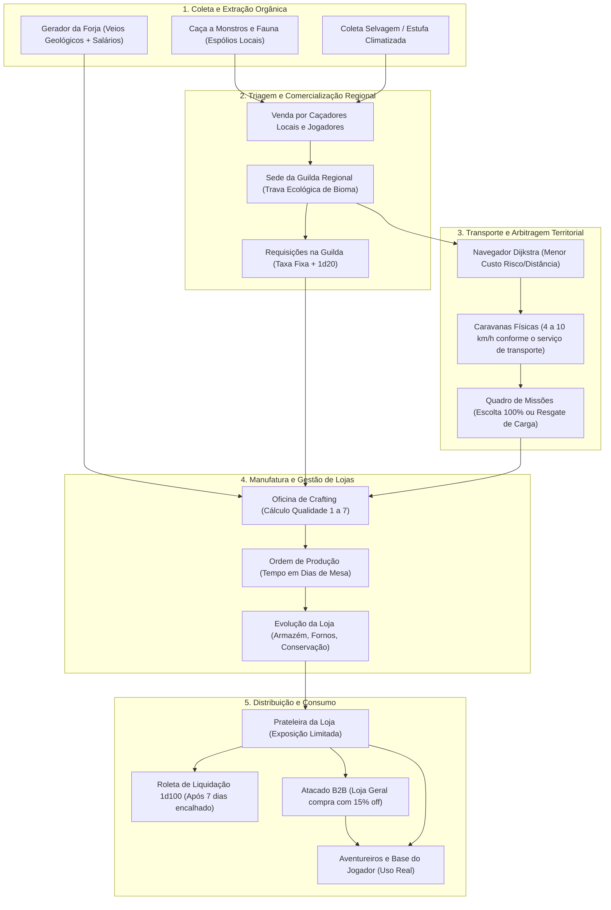

# 💰 Compêndio de Economia, Comércio e Crafting: O Motor Vivo de Thaluria

Este documento é o **Índice Mestre** do ecossistema econômico, comercial, logístico, de manufatura (crafting) e gestão imobiliária de **Thaluria RPG**. O sistema foi concebido sob uma premissa inegociável de **autenticidade e realismo orgânico**: nada surge do vazio; cada moeda possui lastro em latão, cada insumo possui origem concreta e cada mercadoria viaja pelas arestas do território sob os riscos de estradas reais.

---

## 📚 Estrutura Modular da Economia

Para consultar as regras aprofundadas, fórmulas matemáticas e implementações técnicas, consulte os manuais dedicados da pasta `Sistema de Economia/`:

1. **[[Sistema de Economia/01 - Base Monetária e Escala de Latão v2|🪙 01. Base Monetária e Escala de Latão v2]]**
   * A escala canônica decimal de **10 moedas** com base inteira em **Latão (`long`)**, eliminando erros de ponto flutuante.
   * Regras cambiais (do Latão ao Édito Imperial de 100 bilhões de Latões).
   * Normalização automática de carteiras e cálculo de troco atômico.
   * Custo básico de fretes e escoltas em estradas ponderadas.

2. **[[Sistema de Economia/02 - Sistema de Vendas e Caravanas v3|🚛 02. Sistema de Vendas, Caravanas e Navegação v3]]**
   * Os **6 tipos canônicos de lojas** (`FORJA`, `ALFAIATARIA`, `LOJA_GERAL`, `ALQUIMIA`, `JOALHERIA`, `TAVERNA`).
   * Precificação dinâmica de **Oferta e Demanda** com bandas de flutuação (piso de `0.40x` a teto de `2.50x`) e margem de compra NPC (`65%`).
   * Navegação em grafo ponderado com algoritmo de **Dijkstra (`NavegadorGrafo`)**.
   * **Caravanas físicas** com cinemática hora a hora, testes de emboscada, perda de carga e oscilação de perigo nas estradas.
   * Contratos de escolta armada e resgates de carga com lastro financeiro no caixa da loja contratante.

3. **[[Sistema de Economia/03 - Itens, Crafting e Gestão de Lojas v4-v6|📦 03. Itens Táticos, Crafting, Gestão de Lojas e Base v4-v6]]**
   * **Item Modular:** Núcleo enxuto com 8 fichas técnicas acopladas (Armas Brancas, Disparo, Armaduras multi-slot, Escudos, Grimórios, Acessórios, Consumíveis, Materiais).
   * **A Regra do Camarão:** Multiplicadores geográficos por bioma oposto ou abundância nativa (de `0.80x` a `1.85x`).
   * **Crafting v5:** As 5 oficinas de manufatura, cálculo de qualidade em 7 graus (`QualidadeCraft`), herança de nomes e efeitos.
   * **As 4 Restrições Realistas:** Subsistemas concretos (`X, Y, Z`), trava ecológica da Guilda Regional, Árvore de Mineradores da Forja com salários e greves, e Requisições na Guilda com resolução em `1d20`.
   * **Camada v6:** Tempo de fabricação em dias de mesa (`OrdemProducao`), Roleta de Liquidação de prateleira (`1d100`), comércio B2B de atacado (15% off), validade orgânica e apodrecimento, talentos lojistas, IA IRD determinística, contratos nobres urgentes (+50%) e Base do Jogador com estufa climatizada.

4. **[[Sistema de Economia/Arquivo Histórico/Comércio e Geografia em Java (Implementação Crua)|📜 Arquivo Histórico: Arquitetura Crua do Java]]**
   * Registro histórico da primeira versão (v1) dos pacotes `geografia` e `economia`.

5. **[[Sistema de Economia/Arquivo Histórico/Visão Inicial e Requisitos de Projeto (Prompt Original)|📝 Arquivo Histórico: Requisitos Originais do Sistema Comercial]]**
   * Visão conceitual e os 8 requisitos fundamentais que nortearam todo o desenvolvimento.

6. **[[templates/Ficha de Cadastro de Item e Manufatura|📜 Template: Ficha de Cadastro de Item e Manufatura]]**
   * Modelo padronizado para Mestres e desenvolvedores registrarem novos itens e receitas de manufatura.

---

## 🪙 1. Tabela Rápida da Escala Monetária Canônica

Toda a economia é calculada internamente na moeda indivisível **Latão (`PL`)**. O Ouro (`PO`) permanece como referência visual (`1 PO = 10.000 Latões`).

| Moeda | Constante (`Moeda`) | Sigla | Razão de Câmbio | Valor em Latão (`long`) | Valor em Ouro (PO) |
|---|---|:---:|---|---:|---:|
| **Latão** | `LATAO` | `PL` | Unidade Base | **1** | 0,0001 |
| **Ferro** | `FERRO` | `PF` | 1 Ferro = 10 Latões | **10** | 0,001 |
| **Cobre** | `COBRE` | `PC` | 1 Cobre = 10 Ferros | **100** | 0,01 |
| **Prata** | `PRATA` | `PP` | 1 Prata = 10 Cobres | **1.000** | 0,1 |
| **Ouro** | `OURO` | **`PO`** | 1 Ouro = 10 Pratas | **10.000** | **1,0** |
| **Platina** | `PLATINA` | `PT` | 1 Platina = 10 Ouros | **100.000** | 10,0 |
| **Cobalto** | `COBALTO` | `CB` | 1 Cobalto = 10 Platinas | **1.000.000** | 100,0 |
| **Diamante** | `DIAMANTE` | `DI` | 1 Diamante = 10 Cobaltos | **10.000.000** | 1.000,0 |
| **Talento** | `TALENTO` | `TL` | 1 Talento = 10 Diamantes | **100.000.000** | 10.000,0 |
| **Édito** | `EDITO` | `ED` | 1 Édito = 1.000 Talentos | **100.000.000.000** | 10.000.000,0 |

---

## 🏬 2. Matriz dos 6 Estabelecimentos Comerciais

| Estabelecimento | Especialidade | Insumos Demandados | Produtos Confeccionados / Balcão |
|---|---|---|---|
| **`FORJA`** | Metalurgia, Armaria e Ferraria | Minérios brutos, carvão, lingotes | Armas brancas (33 tipos), armaduras de placas, escudos, ferramentas |
| **`ALFAIATARIA`** | Tecelagem e Couro | Couros, peles, lã, linho, seda | Armaduras leves, túnicas reforçadas, mantos de viagem, mochilas |
| **`ALQUIMIA`** | Botica e Transmutação | Ervas medicinais, pós raros, reagentes | Poções de HP, elixires de Mana, antídotos, óleos elementais |
| **`BOTANICA`** | Cultivo e Floricultura | Sementes, bulbos, água purificada | Ervas frescas, raízes restaurativas, flores raras de bioma |
| **`JOALHERIA`** | Ourivesaria e Lapidação | Gemas brutas, cristais, ouro/platina | Acessórios nos 5 slots especiais, anéis mágicos, talismãs com passivas |
| **`TAVERNA`** | Alimentação e Hospedagem | Carnes, cereais, lúpulo, especiarias | Refeições revigorantes, rações de viagem, hidromel, cervejas |
| *(Intermediária)* **`LOJA_GERAL`** | Empório e Varejo Sortido | Mercadorias acabadas via atacado B2B | Tochas, cordas, rações, ferramentas, artigos importados de outras regiões |

---

## 🔨 3. Matriz dos 7 Graus de Qualidade de Manufatura (`QualidadeCraft`)

A qualidade final de uma peça forjada decorre da sinergia entre o nível da oficina e a pureza dos insumos concretos:

| Grau | Nome | Modificador Dano / RD | Bônus Dado Arma | Slots Efeito | Peso | Preço Base |
|:---:|---|:---:|:---:|:---:|:---:|:---:|
| **1** | `PLEBEU` | `0.85x` (-15%) | `+0 faces` | `0 slots` | `+10%` | `0.75x` |
| **2** | `ARTESANAL` | `1.00x` (Padrão) | `+0 faces` | `1 slot` | `0%` | `1.00x` |
| **3** | `REFINADO` | `1.15x` (+15%) | `+0 faces` | `1 slot` | `-5%` | `1.35x` |
| **4** | `NOBRE` | `1.35x` (+35%) | **`+2 faces`** *(d10 $\to$ d12)* | `2 slots` | `-10%` | `1.80x` |
| **5** | `REAL` | `1.60x` (+60%) | **`+2 faces` + `+2 fixo`** | `2 slots` | `-15%` | `2.50x` |
| **6** | `IMPERIAL` | `1.90x` (+90%) | **`+4 faces` + `+4 fixo`** | `3 slots` | `-20%` | `3.50x` |
| **7** | `REGIO_ANCESTRAL` | **`2.30x` (+130%)** | **`+4 faces` + `+1 Dado Extra`** | **`4 slots`** | **`-25%`** | **`5.00x`** |

---

## 🔄 4. O Ciclo Completo da Economia Orgânica

O diagrama abaixo ilustra como a matéria flui no mundo sem geração espontânea:

---

## 🧪 5. Garantia de Qualidade e Cobertura de Testes

Todo o motor econômico é auditado por quatro suítes automatizadas de testes em Java puro, cobrindo **307 asserções críticas com 100% de aprovação**:

| Suíte de Testes | Arquivo Fonte | Testes | Cobertura Validada |
|---|---|:---:|---|
| **E2E Comercial (v3)** | [`TesteEndToEnd.java`](../../src/teste/TesteEndToEnd.java) | **69** | 10 moedas em Latão, Dijkstra, 6 lojas, fretes, caravanas hora a hora, livro-caixa e missões com lastro financeiro |
| **Itens Táticos (v4/v4.1)** | [`TesteItemV4.java`](../../src/teste/TesteItemV4.java) | **79** | Volumetria de mochila, regra do camarão (0.8x a 1.85x), 33 armas brancas, 13 slots corporais, escudos com absorção e passivas |
| **Crafting Avançado (v5)** | [`TesteCraftingV5.java`](../../src/teste/TesteCraftingV5.java) | **92** | Moldes de 5 áreas, 7 graus de qualidade, subsistemas concretos (X, Y, Z), travas ecológicas da Guilda, mineradores com salários/greves e testes 1d20 de requisição |
| **Gestão de Lojas (v6)** | [`TesteGestaoLojasV6.java`](../../src/teste/TesteGestaoLojasV6.java) | **67** | Ordens em dias de mesa, Roleta 1d100 de encalhe, atacado B2B (15% off), apodrecimento orgânico, câmara de conservação, IA IRD determinística, contratos urgentes (+50%) e Base do Jogador com estufa |
| **TOTAL CONSOLIDADO** | — | **307** | **100% de sucesso (Zero dependências externas, Java puro)** |

---

> [!TIP]
> Para cadastrar novas mercadorias ou moldes de manufatura respeitando os subsistemas concretos e a volumetria física, utilize a [[templates/Ficha de Cadastro de Item e Manufatura|Ficha de Cadastro de Item e Manufatura]].
