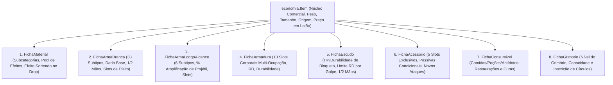

# 📦 Arquitetura de Itens e Integração ao Ecossistema — Thaluria RPG (`Item v4`)

Este documento detalha a estrutura interna da classe [`Item.java`](../src/economia/Item.java) e sua atuação transversal em todo o ecossistema de economia, combate tático, comércio, inventários de aventureiros, simulação autônoma e logística territorial do universo de Thaluria na **Versão 4 (Pré-Crafting Tático)**.

---

## 📑 Sumário

1. [Visão Geral da Arquitetura Modular](#1-visão-geral-da-arquitetura-modular)
2. [Evolução do Núcleo `Item.java`](#2-evolução-do-núcleo-itemjava)
   - [2.1. Enum `TipoItem` (10 Categorias Tipadas)](#21-enum-tipoitem-10-categorias-tipadas)
   - [2.2. Sistema de Tamanho Físico e Volume (`TamanhoItem`)](#22-sistema-de-tamanho-físico-e-volume-tamanhoitem)
   - [2.3. Precificação Geográfica e Exotismo ("Regra do Camarão no Litoral")](#23-precificação-geográfica-e-exotismo-regra-do-camarão-no-litoral)
   - [2.4. Integração Monetária em Latão (`Carteira.java`)](#24-integração-monetária-em-latão-carteirajava)
3. [Motor de Efeitos e Passivas](#3-motor-de-efeitos-e-passivas)
   - [3.1. `EfeitoItem.java`](#31-efeitoitemjava)
   - [3.2. `PassivaItem.java`](#32-passivaitemjava)
4. [As 8 Fichas Técnicas Modulares (Composição)](#4-as-8-fichas-técnicas-modulares-composição)
   - [4.1. `FichaMaterial` (Insumos, Qualidade e Sorteio de Efeitos no Drop)](#41-fichamaterial-insumos-qualidade-e-sorteio-de-efeitos-no-drop)
   - [4.2. `FichaArmaBranca` (As 33 Armas Corpo a Corpo e Evolução de Dano)](#42-fichaarmabranca-as-33-armas-corpo-a-corpo-e-evolução-de-dano)
   - [4.3. `FichaArmaLongoAlcance` (As 6 Armas de Disparo e Amplificação de Projétil)](#43-fichaarmalongoalcance-as-6-armas-de-disparo-e-amplificação-de-projétil)
   - [4.4. `FichaArmadura` (Os 13 Slots Corporais com Multi-Ocupação, RD e Durabilidade)](#44-fichaarmadura-os-13-slots-corporais-com-multi-ocupação-rd-e-durabilidade)
   - [4.5. `FichaEscudo` (HP de Bloqueio, Limite de Absorção por Golpe e Vazamento)](#45-fichaescudo-hp-de-bloqueio-limite-de-absorção-por-golpe-e-vazamento)
   - [4.6. `FichaAcessorio` (Os 5 Slots Exclusivos, Passivas e Novas Habilidades)](#46-fichaacessorio-os-5-slots-exclusivos-passivas-e-novas-habilidades)
   - [4.7. `FichaConsumivel` (Restauração e Remoção de Condições)](#47-fichaconsumivel-restauração-e-remoção-de-condições)
   - [4.8. `FichaGrimorio` e `CirculoMagico` (Nível Arcano e Inscrição de Magias)](#48-fichagrimorio-e-circulomagico-nível-arcano-e-inscrição-de-magias)
5. [Integração com a Ficha do Personagem (`Ficha.java`)](#5-integração-com-a-ficha-do-personagem-fichajava)
6. [O Item no Ecossistema Global (Lojas, Caravanas e Simulação)](#6-o-item-no-ecossistema-global-lojas-caravanas-e-simulação)
7. [Garantia de Qualidade e Testes Automatizados (120 Testes)](#7-garantia-de-qualidade-e-testes-automatizados-120-testes)

---

## 1. Visão Geral da Arquitetura Modular

A **Versão 4** do sistema de itens adota o princípio de **Composição Modular**. O [`Item.java`](../src/economia/Item.java) permanece como a entidade central universal para todas as operações econômicas, de transporte e inventário, enquanto detalhes táticos e mecânicos específicos são encapsulados em **Fichas Técnicas Dedicadas**:

Essa separação garante que itens simples (como maçãs ou lingotes) não carreguem atributos desnecessários de combate, mantendo o consumo de memória enxuto e o código desacoplado.

---

## 2. Evolução do Núcleo `Item.java`

### 2.1. Enum `TipoItem` (10 Categorias Tipadas)

O enum foi expandido para cobrir todas as funções táticas do jogo, preservando `ARMA` para compatibilidade retroativa:

| Tipo | Nome Formatado | Finalidade Tática |
|---|---|---|
| `ARMA_BRANCA` | Arma Branca / Corpo a Corpo | Lâminas, machados, hastes e armas de impacto com dado base de dano. |
| `ARMA_LONGO_ALCANCE` | Arma de Longo Alcance | Disparadores (arcos, bestas) com amplificação percentual de dano. |
| `PROJETIL` | Projétil / Munição | Flechas, virotes e dardos com dano base consumidos nos disparos. |
| `ARMADURA` | Armadura | Proteção corporal com RD, durabilidade e ocupação multi-slot. |
| `ESCUDO` | Escudo | Absorção ativa de golpes com HP próprio e limite de impacto. |
| `CONSUMIVEL` | Consumível | Poções, elixires, alimentos, bebidas e antídotos. |
| `ACESSORIO` | Acessório | Joias, anéis e talismãs nos 5 slots especiais com passivas e novos ataques. |
| `MATERIAL` | Material de Forja | Metais, madeiras, gemas e espólios com sorteio de efeitos de crafting. |
| `MAGICO` | Item Mágico / Grimório | Grimórios com círculos mágicos e artefatos de feitiçaria. |
| `OUTRO` | Geral | Ferramentas, mochilas e mercadorias comuns. |
| *(Legado) `ARMA`* | Arma | Mantido para compatibilidade total com cenários legados v3. |

---

### 2.2. Sistema de Tamanho Físico e Volume (`TamanhoItem`)

Além do peso (`double peso` em kg), todo item possui um [`TamanhoItem`](../src/economia/TamanhoItem.java) que define a ocupação volumétrica dentro da mochila:

| Enum `TamanhoItem` | Slots Ocupados | Cabe em Mochila Comum? | Exemplos Práticos |
|---|:---:|:---:|---|
| **`MINUSCULO`** | `0.1` | ✅ Sim | Anéis, gemas, moedas, ervas, agulhas |
| **`PEQUENO`** | `1.0` | ✅ Sim | Adagas, poções, carnes cortadas, maçãs, grimórios de bolso |
| **`MEDIO`** | `3.0` | ✅ Sim | Espadas longas, botas, elmos, lingotes, escudos leves |
| **`GRANDE`** | `8.0` | ⚠️ Apenas mochilas grandes | Montantes, alabardas, peitorais pesados, peles de urso |
| **`COLOSSAL`** | `25.0+` | ❌ **Não cabe na mochila** | Crânios de dragão, toras de madeira, bigornas *(exige carroça/caravana)* |

O volume total de uma pilha é obtido via:
$$\text{Espaço Total} = \text{Tamanho.getSlotsMochila()} \times \text{quantidade}$$

---

### 2.3. Precificação Geográfica e Exotismo ("Regra do Camarão no Litoral")

A classe `Item` armazena opcionalmente sua assinatura geográfica nativa:
- `Regiao regiaoOrigem`
- `Geologia geologiaOrigem`
- `Aquifero aquiferoOrigem`

Ao ser cotado em uma [`Cidade`](../src/geografia/Cidade.java), o método `calcularMultiplicadorRegional(Cidade)` ajusta o valor dinamicamente:

1. **Abundância Local (Origem Nativa): Multiplicador `0.80x` (-20%)**
   - Todos os critérios definidos coincidem com a cidade (ex: *Camarão da Costa* em *Porto Oakhaven*, que possui `OCEANO_AGUAS_COSTEIRAS` e porto ativo).
2. **Bioma Oposto / Especiaria Exótica: Multiplicador `1.85x` (+85%)**
   - O item vem de um clima extremo oposto (ex: produto de `TUNDRA` em `DESERTO`, ou produto marítimo vendido em deserto árido sem acesso ao mar).
3. **Bioma Neutro / Próximo: Multiplicador `1.25x` (+25%)**
   - Cidade do interior ou região vizinha (ex: camarão vendido em *Valdorian*, cidade temperada com rio).
4. **Itens sem Origem Definida:** Multiplicador neutro `1.0x` (preserva 100% das cotações canônicas da v3).

---

### 2.4. Integração Monetária em Latão (`Carteira.java`)

Todas as cotações, transações e fretes continuam ancorados na base de **10 Moedas calculadas em Latão (`long`)**, eliminando imprecisões de ponto flutuante:
- `getPrecoEmLatao()`: Converte o preço base em PO para Latão via `Carteira.ouroParaLatao(this.preco)`.
- `getValorTotalEmLatao()`: `getPrecoEmLatao() * this.quantidade`.

---

## 3. Motor de Efeitos e Passivas

### 3.1. `EfeitoItem.java`
Modela efeitos elementais, danos secundários e condições especiais:
- **Gatilhos (`GatilhoEfeito`):** `AO_ACERTAR`, `AO_SOFRER_DANO`, `AO_CONSUMIR`, `PASSIVO_CONTINUO`, `CURA_CONDICAO`.
- **Atributos:** `dadoDanoOuCura` (ex: `"1d4"`, `"2d6"`), `elementoOuStatus` (ex: `"Gelo / Congelamento"`, `"Fogo"`), `duracaoTurnos`.

### 3.2. `PassivaItem.java`
Modela passivas táticas atreladas a acessórios e equipamentos:
- **Atributos:** `nomePassiva`, `condicaoAtivacao` (ex: `"Quando o HP cair abaixo de 30%"`), `efeitoMecanico` (ex: `"Ganha +20% Roubo de Vida por 3 turnos"`), `tempoRecargaTurnos` (cooldown) e controle de turnos restantes.

---

## 4. As 8 Fichas Técnicas Modulares (Composição)

### 4.1. `FichaMaterial` (Insumos, Qualidade e Sorteio de Efeitos no Drop)
- **Subtipos (`SubtipoMaterial`):** `METAL_LINGOTE`, `MINERIO_BRUTO`, `GEMA_CRISTAL`, `MADEIRA_FIBRA`, `COURO_PELE`, `PLANTA_ERVA`, `COMIDA_INSUMO`, `ESPOLIO_MONSTRO`.
- **Qualidade:** Níveis 1 a 5.
- **Bônus de Forja:** `bonusFacesDadoArma` (ex: metal refinado concedendo +2 faces em armas) e `bonusResistenciaArmadura` (+RD em proteções).
- **Sorteio no Drop:** Contém uma lista `efeitosPossiveis`. Ao abater o monstro ou gerar o lote, `sortearEfeitoNoDrop(Random)` sorteia 1 efeito e o fixa em `efeitoAtribuido`.

---

### 4.2. `FichaArmaBranca` (As 33 Armas Corpo a Corpo e Evolução de Dano)

Organizada em 6 grupos com as **33 armas canônicas**:
1. **Espadas (11):** `ESPADA_CURTA`, `ESPADA_LONGA`, `ESPADA_CURVA`, `ESPADA_LARGA`, `SABRE`, `CIMITARRA`, `ALFANJE`, `RAPIEIRA`, `FLORETE`, `KATANA`, `MONTANTE`.
2. **Lâminas Curtas (3):** `ADAGA`, `KUKRI`, `KATAR`.
3. **Machados (4):** `MACHADO_CURTO`, `MACHADO_DE_BATALHA`, `MACHADO_DUPLO`, `MACHADO_DE_HASTE`.
4. **Contusão (4):** `CLAVA`, `MACA`, `MARTELO_DE_GUERRA`, `MARTELO_DE_DUAS_MAOS`.
5. **Hastes e Alcance (8):** `CHICOTE`, `LANCA_CURTA`, `LANCA_LONGA`, `ALABARDA`, `GLAIVE`, `LANCA_DE_CAVALARIA`, `TRIDENTE`, `BIDENTE`.
6. **Pugilato / Curto Alcance (3):** `GARRAS`, `SOQUEIRA`, `MANOPLA_DE_COMBATE`.

- **Empunhadura:** `UMA_MAO` ou `DUAS_MAOS`.
- **Evolução de Faces:** `getFacesTotal() = facesDadoBase + bonusFacesDado` (ex: Katana 1d10 forjada com metal nobre sobe automaticamente para **1d12**).
- **Slots de Engaste:** Recebe efeitos especiais de materiais e runas (ex: *Corte Congelante*).

---

### 4.3. `FichaArmaLongoAlcance` (As 6 Armas de Disparo e Amplificação de Projétil)

- **Subtipos (`SubtipoArmaDistante`):** `ARCO_CURTO`, `ARCO_LONGO`, `BESTA_LEVE`, `BESTA_PESADA`, `ZARABATANA`, `ESTILINGUE`.
- **Mecânica de Amplificação:** O disparador não possui dano fixo próprio; ele amplifica o projétil disparado:
$$\text{Dano do Disparo} = \text{Dano da Flecha} \times \text{Multiplicador de Amplificação}$$
- **Atributos:** `multiplicadorAmplificacao` (ex: 1.20x a 1.75x), `alcanceMetros` (15m a 60m) e slots de engaste.

---

### 4.4. `FichaArmadura` (Os 13 Slots Corporais com Multi-Ocupação, RD e Durabilidade)

- **Os 13 Slots Exclusivos de Armadura:** `CABECA`, `ROSTO`, `PESCOCO`, `OMBROS`, `PEITO`, `COSTAS`, `BRACOS`, `COTOVELOS`, `MAOS`, `CINTURA`, `PERNAS`, `JOELHOS`, `PES`.
- **Multi-Ocupação (`EnumSet<SlotArmadura>`):** Peças ocupam conjuntos anatômicos:
  - *Capuz Simples:* `[CABECA]`
  - *Elmo Fechado:* `[CABECA, ROSTO]`
  - *Armadura Completa de Placas:* `[PEITO, COSTAS, OMBROS, CINTURA]`
- **Redução de Dano e Durabilidade:** A proteção de RD é direta. Ao sofrer desgaste e chegar a `0` de durabilidade, a armadura entra em estado `estaQuebrada()` e perde temporariamente a sua RD até ser reparada.

---

### 4.5. `FichaEscudo` (HP de Bloqueio, Limite de Absorção por Golpe e Vazamento)

- **Empunhadura:** `UMA_MAO` (broquel, escudo redondo) ou `DUAS_MAOS` (escudo torre / pavis).
- **Atributos:** `hpMaximo`, `hpAtual` (vida do escudo) e `limiteSegurarPorGolpe` (resistência máxima estrutural por impacto).
- **Mecânica de Bloqueio (`absorverGolpe`):**
  - Se $\text{Dano} \le \text{Limite}$: O escudo absorve 100% do impacto, reduzindo seu `hpAtual`, e o herói sofre **`0` de dano**.
  - Se $\text{Dano} > \text{Limite}$: O escudo absorve até o seu limite, e o **dano excedente vaza para o defensor**.

---

### 4.6. `FichaAcessorio` (Os 5 Slots Exclusivos, Passivas e Novas Habilidades)

- **Os 5 Slots Segregados:** `ORELHAS`, `OLHOS`, `ANTEBRACOS`, `ANEIS`, `ACESSORIO_GERAL` (garantindo que nunca conflitem com armaduras).
- **Poderes Concedidos:** Bônus diretos de atributos (`FORCA`, `DESTREZA`, `VIGOR`), habilidades passivas condicionais e destravamento de novas técnicas de ataque.

---

### 4.7. `FichaConsumivel` (Restauração e Remoção de Condições)

- **Restaurações:** `restauracaoVida`, `restauracaoMana`, `restauracaoVigor`.
- **Cura de Condições:** Remove aflições como *Envenenamento*, *Paralisia*, *Sangramento* e *Exaustão*.
- **Efeitos Aplicados:** Buffs temporários de culinária e elixires alquímicos.

---

### 4.8. `FichaGrimorio` e `CirculoMagico` (Nível Arcano e Inscrição de Magias)

- **`CirculoMagico`:** Contém nome do feitiço, nível do círculo (1 a 5), custo em mana, diagrama rúnico e efeito arcano.
- **`FichaGrimorio`:** Possui nível arcano (1 a 5) e capacidade máxima de páginas. O método `inscreverCirculo(CirculoMagico)` rejeita magias cujo nível supere a tolerância do livro, evitando que as páginas se desintegrem pelo excesso de éter.

---

## 5. Integração com a Ficha do Personagem (`Ficha.java`)

A classe [`Ficha.java`](../src/personagem/Ficha.java) agora opera como o centro de comando de equipamentos do herói:

1. **Validação de Mochila e Carga:**
   - Capacidade de Carga: Baseada em Vigor e Força ($\text{Carga Máx} = 50 + \text{FOR} \times 3 + \text{VIG} \times 2$ kg);
   - Capacidade Volumétrica: Mochila com 50.0 slots;
   - Método `adicionarAoInventarioComValidacao(Item)`: Rejeita itens colossais e cargas que superem o limite físico do aventureiro.
2. **Equipamento de Armaduras Multi-Slot:**
   - `equiparArmadura(Item)`: Valida se todos os slots anatômicos exigidos pela peça estão livres. Se houver sobreposição, o equipamento é rejeitado.
   - `desequiparArmadura(SlotArmadura)`: Libera todos os slots ocupados por aquela peça e a devolve ao inventário.
   - `calcularReducaoDanoTotalArmaduras()`: Soma o RD de todas as peças ativas sem duplicações.
3. **Equipamento de Acessórios:**
   - `equiparAcessorio(Item)`: Valida os 5 slots exclusivos.
4. **Empunhadura de Combate:**
   - `equiparMaoPrincipal(Item)` / `equiparMaoSecundaria(Item)`: Valida armas de 1 vs 2 mãos. Se o herói estiver empunhando um *Montante* ou *Arco Longo*, o sistema impede empunhar itens na mão secundária.

---

## 6. O Item no Ecossistema Global (Lojas, Caravanas e Simulação)

- **Precificação em [`Lojas.java`](../src/economia/Lojas.java):** O cálculo dinâmico de Latão incorpora o multiplicador regional:
  $$\text{Preço em Latão} = \text{Preço Base} \times \text{Multiplicador Oferta/Demanda} \times \text{Multiplicador Regional}$$
- **Clonagem Segura (`Lojas.clonarItem`):** Clona com segurança todas as 8 fichas modulares, garantindo imutabilidade e ausência de efeitos colaterais de memória entre lojistas e aventureiros.
- **Logística em [`Caravana.java`](../src/economia/Caravana.java):** Cargas continuam utilizando o peso total acumulado para cálculo de frete e risco de emboscada no grafo geográfico de Thaluria.

---

## 7. Garantia de Qualidade e Testes Automatizados (199 Testes)

O ecossistema é validado por três suítes automatizadas de testes executadas de forma contínua:

| Suíte de Testes | Arquivo | Cobertura | Status |
|---|---|---|:---:|
| **Suite de Testes E2E (v3)** | [`TesteEndToEnd.java`](../src/teste/TesteEndToEnd.java) | Economia de 10 moedas, 6 lojas, Dijkstra, caravanas, livro-caixa e missões | **69/69 PASSARAM (100%)** |
| **Suite de Testes Item v4 & v4.1** | [`TesteItemV4.java`](../src/teste/TesteItemV4.java) | Mochila, regra do camarão, 33 armas, 13 slots, escudos, grimórios, QualidadeCraft, Drops e Passivas | **79/79 PASSARAM (100%)** |
| **Suite de Testes Crafting (v5)** | [`TesteCraftingV5.java`](../src/teste/TesteCraftingV5.java) | MoldeReceita, OficinaCrafting, 5 áreas, 7 qualidades, insumos genéricos vs específicos, cadeia autônoma | **51/51 PASSARAM (100%)** |
| **TOTAL CONSOLIDADO** | — | **Validação completa de regressão e novas funcionalidades** | **199/199 PASSARAM (100%)** |

---

## 8. Item v4.1: A Tríade Canônica entre Drops, Crafting e Combate Real

A camada **Item v4.1** fecha a integração definitiva entre Exploração/Drops, Manufatura (Crafting) e Combate com status dinâmicos.

### 8.1. Separação Canônica: `RaridadeItem` vs. `QualidadeCraft`

Cada item possui agora uma **`OrigemItem`** bem definida:

1. **`COLETAVEL_OU_DROP` (Drops de Criaturas, Minérios Brutos, Ervas, Relíquias):**
   * Classificado pelos **6 Graus de `RaridadeItem`**:
     `COMUM` $\to$ `INCOMUM` $\to$ `RARO` $\to$ `EPICO` $\to$ `LENDARIO` $\to$ **`MITICO`**.
2. **`MANUFATURADO_CRAFT` (Armas, Armaduras, Joias, Poções e Grimórios forjados):**
   * Classificado pelos **7 Graus de `QualidadeCraft`**:
     `PLEBEU` $\to$ `ARTESANAL` $\to$ `REFINADO` $\to$ `NOBRE` $\to$ `REAL` $\to$ `IMPERIAL` $\to$ **`REGIO_ANCESTRAL`**.

### 8.2. Matriz Mecânica dos 7 Graus de `QualidadeCraft`

| Grau (`QualidadeCraft`) | Mult. Dano / Status / Cura | Dado da Arma Branca | Slots de Efeito | Ergonomia (Peso) | Durabilidade / HP Escudo | Maestria & Grimório | Mult. Preço Base |
|---|---|---|---|---|---|---|---|
| **`PLEBEU`** | `0.85x` (-15%) | `+0 faces` | `0 slots` | `+10%` (Mais pesado) | `0.80x` | `+0 pág` / Sem red. CD | `0.75x` |
| **`ARTESANAL`** | `1.00x` (Base) | `+0 faces` | `1 slot` | `0%` (Padrão) | `1.00x` | `+0 pág` / Sem red. CD | `1.00x` |
| **`REFINADO`** | `1.15x` (+15%) | `+0 faces` | `1 slot` | `-5%` peso | `1.25x` | `+1 pág` no Grimório | `1.35x` |
| **`NOBRE`** | `1.35x` (+35%) | **`+2 faces`** *(ex: d10 $\to$ d12)* | `2 slots` | `-10%` peso | `1.50x` | `+2 pág` / `-1 turno` CD | `1.80x` |
| **`REAL`** | `1.60x` (+60%) | **`+2 faces`** + `+2 Fixo` | `2 slots` | `-15%` peso | `1.85x` | `+3 pág` / `-1 turno` CD | `2.50x` |
| **`IMPERIAL`** | `1.90x` (+90%) | **`+4 faces`** + `+4 Fixo` | `3 slots` | `-20%` peso | `2.30x` | `+4 pág` / `-2 turnos` CD | `3.50x` |
| **`REGIO_ANCESTRAL`** | **`2.30x` (+130%)** | **`+4 faces`** + **`+1 Dado Extra`** | **`4 slots`** | **`-25%` peso** | **`3.00x`** | **`+6 pág`** / **`-2 turnos` CD** | **`5.00x`** |

### 8.3. Herança Geográfica de Monstros (`configurarComoDropDeMonstro`)
Quando uma criatura é derrotada, o item dropado herda imediatamente o bioma (`Regiao`), o terreno (`Geologia`) e a água subterrânea (`Aquifero`) do habitat do monstro. Ao ser transportado para outras regiões, o sistema de comércio aplica automaticamente o multiplicador de especiaria exótica da **Regra do Camarão** (até **`1.85x`** em climas e geologias opostas).

### 8.4. Passivas Executáveis e Modificadores Reais na `Ficha.java`
- **`EfeitoItem`:** Carrega `multiplicadorDano` (ex.: `2.0x` para dobrar dano), `bonusStatus` (`Map<String, Integer>` para Força, Destreza, RD, etc.), e `curaInstantaneaHp`.
- **`PassivaItem`:** Possui `TipoCondicaoPassiva` (`SEMPRE_ATIVA_AO_EQUIPAR`, `VIDA_ABAIXO_PERCENTUAL`, `AO_CAUSAR_CRITICO`, etc.) e método `tentarAtivar(...)`.
- **`Ficha.java`:** Avalia passivas em tempo de combate, calcula `getMultiplicadorDanoTotal()` e `getAtributoEfetivo(...)`, integrando joias, consumíveis e equipamentos em tempo real.

---

## 9. Sistema de Crafting v5: Manufatura Inteligente e Cadeia de Suprimentos

A versão 5 implementa o motor de manufatura completo, unindo matérias-primas e moldes com o sistema econômico autônomo.

### 9.1. Classes do Núcleo de Crafting
- **[`MoldeReceita.java`](../src/economia/MoldeReceita.java):** Define os templates para as 5 áreas (`FORJA`, `ALFAIATARIA`, `JOALHERIA`, `TAVERNA`, `BOTANICA`), nível de receita (1 a 5), custo de mão de obra em Latão, e os requisitos de insumo (`RequisitoInsumo`).
- **[`OficinaCrafting.java`](../src/economia/OficinaCrafting.java):** Valida ferramentais, consome matérias-primas, calcula a `QualidadeCraft` (1 a 7), aplica bônus de metal/resistência, injeta efeitos nos slots e gera a peça pronta.
- **[`FichaMaterial.java`](../src/economia/FichaMaterial.java):** Suporta materiais genéricos (ex: *Couro Curtido Q2*) vs. específicos (ex: *Escamas de Dragão*, *Camarão da Costa*), transmitindo nomenclatura e assinaturas geográficas.

### 9.2. A Ponte Matemática da Qualidade (1 a 7)
$$Q_{\text{efetiva}} = \min(\text{nivelLoja} + 1, \; \text{qualidadeMaterial})$$
$$P_{\text{base}} = (\text{Média de } Q_{\text{efetiva}} \times 0.60) + (\text{nivelLoja} \times 0.40)$$
$$\text{Grau Final} = \text{clamp}\left(1, \; 7, \; \text{round}(P_{\text{base}}) + B_{\text{raridade}}\right)$$

* $B_{\text{raridade}} = -1$ (Penalidade de Improviso se Nível 1 com Mat Q1).
* $B_{\text{raridade}} = +1$ (Excedente Técnico se Loja $\ge$ Receita + 2 e Q $\ge$ 4, ou uso de insumo Épico/Lendário).
* $B_{\text{raridade}} = +2$ (Bônus Ancestral se Loja Nível 5 + Insumo Mítico/Lendário Q5).

### 9.3. Integração com Lojas e o Motor Econômico
1. **Produção Autônoma:** Toda loja possui `nivelLoja` (1 a 5), `livroDeReceitas` e método `processarCraftingDiario(dia, hora)`.
2. **Auditoria Contábil:** Toda manufatura debita mão de obra do caixa e registra `PRODUCAO_CRAFTING` no histórico com saldo atualizado.
3. **Cadeia de Suprimentos:** Se faltar matéria-prima na oficina, a loja eleva automaticamente a demanda do insumo; o `MotorEconomico` despacha caravanas intermunicipais via Dijkstra para buscar a matéria-prima em outras cidades, alimentando o ciclo produtivo.

