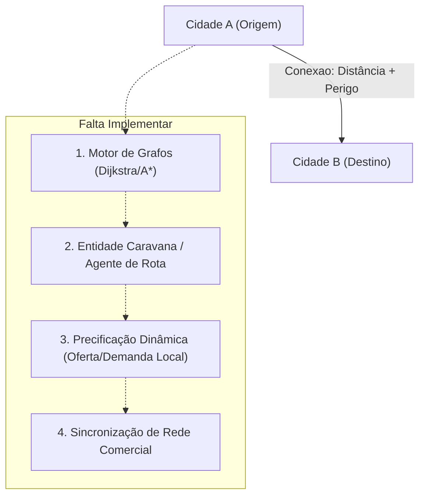

# ⚔️ RPG Thaluria: Relatório Geral do Projeto

> **Status do Repositório:** Limpeza e auditoria concluídas. Todos os arquivos binários compilados (`.class`) foram removidos do código-fonte e o arquivo `.gitignore` foi configurado para blindar o versionamento.

---

## 🧭 1. Visão Geral da Arquitetura

O projeto **RPG Thaluria** opera sob uma arquitetura híbrida e complementar de duas frentes:

```
rpg/
├── docs/                   # 📚 Cofre do Obsidian: Lore, Manuais, Fórmulas e Regras
│   ├── Status.md           # Sistema canônico de atributos, recursos, combate e ascensão
│   ├── Compêndio de Grafiturgia Elemental.md  # Índice mestre do sistema de magia em grafos
│   ├── Compêndio de Raças por Reino.md        # Catálogo geopolítico e espécies por bioma
│   ├── Sistema de Magia/   # 6 Manuais modulares da Grafiturgia (Teoria dos Grafos)
│   ├── raças/              # 10 Fichas aprofundadas com constantes raciais e técnicas natas
│   └── templates/          # Modelos padronizados para criação de magias e raças
│
└── src/                    # ☕ Motor em Java (Puro, sem dependências externas)
    ├── geografia/          # Malha territorial, relevo, biomas e topologia de grafos
    ├── economia/           # Sistema monetário, lojas, redes comerciais e itens
    └── personagem/         # Ficha canônica traduzindo matematicamente Status.md
```

---

## 📚 2. Cofre de Regras e Documentação (`docs/`)

### 2.1. O Sistema Canônico de Status (`docs/Status.md`)
Estrutura baseada em dois pilares fundamentais, com atributos individuais de 0 a 100 organizados em **Graus (Tiers)** a cada 10 pontos:

* **Pilar Físico (A Matéria):**
  * `Vigor (VIG)`: Integridade corporal, base de HP e fôlego.
  * `Força (FOR)`: Potência muscular, tração física e sobrecarga.
  * `Destreza (DES)`: Cinética, esquiva, coordenação e precisão.
* **Pilar Etéreo (O Imaterial):**
  * `Mental (MEN)`: Raciocínio tático, percepção e arcanismo.
  * `Espírito (ESP)`: Condutividade de Mana e canalização elemental.
  * `Vontade (VON)`: Resiliência psicológica, sanidade e escudo da alma.

#### Malha de Equações Estruturais
$$\begin{aligned}
\text{Pontos de Vida (HP)} &= 20 + (VIG \times 3) + FOR + VON \\
\text{Sanidade (SAN)} &= 20 + (VON \times 3) + MEN + VIG \\
\text{Energia (Stamina)} &= 10 + (VIG \times 2) + FOR + MEN \\
\text{Mana (Combustível Mágico)} &= 10 + (ESP \times 2) + VON + VIG \\
\text{Defesa Física (Esquiva/Bloqueio)} &= 5 + DES + \lfloor MEN / 2 \rfloor \\
\text{Defesa Oculta (Resistência Mental)} &= 5 + VON + \lfloor VIG / 2 \rfloor
\end{aligned}$$

#### Ciclo Metabólico, Descanso e Colapsos
* **Regen de Mana em Combate:** $1 + \lfloor(ESP + VON)/5\rfloor$ por turno (a cada 2 de Mana, queima 1 de Energia biológica).
* **Descanso e Recuperação:** Multiplicador de ambiente $Q$ (de $0.25$ [Hostil] até $1.50$ [Luxuoso]) aplicando fórmulas proporcionais às horas ($H \in [1, 8]$).
* **Consequências de Zero:** HP 0 (Morrendo em $3 + \lfloor Grau_{VIG}/2 \rfloor$ turnos), SAN 0 (Catatonia/Histeria), Energia 0 (Músculos travados; técnicas físicas rasgam HP), Mana 0 (Burnout; conjurações forçadas custam o dobro em SAN).

#### Equilíbrio Algorítmico: Potencial de Alma (PA) e Índice de Ameaça (IA)
Uma equação quadrática não-linear normalizada na base 10.000 que penaliza a falta de harmonia entre o maior e menor status:
$$PA / IA = \frac{\left[ \left(\frac{FOR^2 + DES^2 + ESP^2 + MEN^2}{2,5}\right) + \Big((VIG + VON) \times (DES + MEN)\Big) \right] \times \left(1 - \frac{\text{Maior} - \text{Menor}}{100}\right)}{5,6}$$
* **Para Monstros:** Define Ranks de **F** (0-49 IA) até **SSS** (10.000 IA) e **EX** (10.001+).
* **Para Jogadores:** Define o **Nível de Ressonância** ($NR = \lfloor\sqrt{PA}\rfloor$), a **Ordem** ($O = \lfloor NR/10 \rfloor$) e os 10 **Patamares de Ascensão** (de *Mortal* a *Transcendente*).
* **Sistema de Perícias:** Rolagem por $(Grau)d20 + (Maestria \times 5)$, com desvantagem no Grau 0 (pega o pior resultado de 2d20).

---

### 2.2. Grafiturgia Elemental (`docs/Sistema de Magia/`)
A magia em Thaluria é compilada rigorosamente como **Teoria dos Grafos**, onde os elementos são nós e os canais de fluxo são arestas:

1. **01 - Limite Mental:** O número de vértices ativos é limitado por $|V| \le 2 + Grau_{MEN}$. Tentar manter mais nós causa *Sobrecarga Neural*.
2. **02 - Matriz Elemental e Regra das Pontes:**
   * 10 elementos: Fogo, Água, Terra, Vento, Raio, Gelo, Luz, Sombra, Caos e Ordem.
   * Pesos nas arestas: $W=1$ (Harmônicos), $W=2$ (Neutros), $W=\infty$ (Antagônicos diretos).
   * **Lei do Vértice Ponte:** Elementos opostos (ex: Fogo e Gelo) só coexistem no mesmo grafo se interligados por um nó intermediário compatível (Ponte).
3. **03 - Topologias e Geometria dos Feitiços:**
   * **Caminho/Ciclo Hamiltoniano:** Foco único e projéteis balísticos (bônus de ciclo $+5 \times Grau$).
   * **Grafo Estrela / Euleriano:** Explosões radiais e impacto em área (AoE).
   * **Grafo Regular ($K_n$):** Barreiras, escudos e armaduras com dispersão homogênea.
   * **Árvores e Digrafos Acíclicos:** Maldições graduais e armadilhas persistentes.
4. **04 - Protocolo do Mestre e Colapso de Grafo:**
   * Fórmulas: $\text{Custo de Mana} = (\sum W) \times 2 \times Grau$ e $\text{Dano} = |V| \text{ dados}$.
   * Tabela de Colapso e Inversão de Feitiço em caso de falha arcana.
5. **05 - Grimório Prático:** 4 magias canônicas prontas (*Lança do Eclipse Gélido*, *Supernova Vulcânica*, *Baluarte de Diamante*, *Prisão Gravitacional*).
6. **06 - Metamagia Algorítmica Avançada:**
   * **Contração de Blossom:** Encapsulamento de ciclos ímpares que explodem em 2 tempos ignorando defesas físicas.
   * **Emparelhamento Perfeito:** Grafos Bipartidos para combos cooperativos entre 2 magos dividindo o custo de Mana.
   * **Poda de Kruskal (MST):** Redução de arestas sob emergência para cortar custos de Mana em tempo real.
   * **Vértices de Articulação:** Mecânica de *Dispel* cirúrgico atacando a conectividade ($\kappa$).

---

### 2.3. Catálogo de Raças por Biomas e Reinos (`docs/raças/`)
10 raças balanceadas com limites de geração inicial, 2 modificadores exclusivos (1 estrutural de status e 1 metabólico) e 1 ataque nato tático:

| Reino / Bioma | Raça | Modificador Estrutural | Modificador Metabólico | Ataque Nato |
| :--- | :--- | :--- | :--- | :--- |
| **Frosthelm** *(Gélido/Montanha)* | **Anões** | Defesa = $8 + DES + \lfloor FOR/2 \rfloor$ | Morte em $5 + Grau_{VIG}$ turnos | Impacto Sísmico (Caído) |
| | **Genasi do Gelo/Água** | Mana = $15 + (ESP \times 3) + VON + VIG$ | 1 Energia para cada 4 Mana | Estilhaço Criogênico (Lança) |
| **Sylvanor** *(Florestal/Bosques)* | **Elfos da Floresta** | Energia = $15 + (VIG \times 2) + DES + MEN$ | Descanso base 10 com $VIG \times 3$ | Disparo do Zéfiro (Flecha Guiada) |
| | **Fadas (Pixies)** | Defesa = $8 + (DES \times 2) + \lfloor MEN/2 \rfloor$ | Custo de Mana 0 cobra apenas $1 \times SAN$ | Poeira Feérica (Cegueira) |
| **Aurelia** *(Deserto/Árido)* | **Homens-Lagarto** | HP = $25 + (VIG \times 4) + FOR + VON$ | Morte com $Grau_{VON}$ somado | Bote da Mandíbula Voraz |
| | **Kobolds** | Defesa = $5 + DES + MEN$ integral | Descanso sem penalidade em solo hostil | Golpe Sujo (Frasco de Cal) |
| **Drakos** *(Vulcânico/Cinzas)* | **Draconatos** | HP = $25 + (VIG \times 3) + (FOR \times 2) + VON$ | Tensão física sem Energia cobra metade | Sopro Draconiano (Elemento 1d8) |
| | **Genasi do Fogo** | Mana = $10 + (ESP \times 2) + (VON \times 2) + VIG$ | Regen Mana = $2 + \lfloor(ESP + VON)/4\rfloor$ | Pulso de Brasas (Empurrão) |
| **Valthera** *(Sombrio/Pântanos)* | **Drow** | Defesa Oculta = $8 + VON + \lfloor MEN/2 \rfloor$ | SAN recupera em $H \ge 2\text{h}$ com base 10 | Veneno das Sombras (Adaga) |
| | **Shadar-kai** | Defesa Oculta = $5 + (VON \times 2) + \lfloor VIG/2 \rfloor$ | Esgotamento de SAN não causa Catatonia | Salto Umbral (Teleporte) |

---

## ☕ 3. Código-Fonte em Java (`src/`)

### 3.1. Pacote `geografia` (A Malha e Topologia do Mundo)
* **`Cidade.java` (Os Vértices $V$):**
  * Modela assentamentos (`CIDADE`, `REINO`, `VILA`, `FORTALEZA`).
  * Atributos de bioma (`Regiao`), relevo (`Geologia`), corpos d'água (`Aquifero`), presença de `porto` e marcação de `fronteira`.
  * Gerencia lista de rotas (`conexoes`) e lista de entrepostos (`lojas`).
  * Fornece busca de vizinhos navegáveis (`listarCidadesVizinhas()`).
  * Inclui algoritmos clássicos implementados: **Merge Sort** (`ordenarCidadesPorId`) e **Busca Binária** (`buscarCidadePorId`).
* **`Conexao.java` (As Arestas Ponderadas $E$):**
  * Liga duas cidades de forma bidirecional.
  * Pesos: `distanciaKm` (comprimento) e `perigo` (escala 1 a 10).
  * Modalidade: `TERRESTRE` ou `MARITIMA` (exige `temPorto()` em ambas as pontas).
  * Estado dinâmico: flag `bloqueada` para simular desastres, guerras ou bloqueios de estrada.
* **Enums de Suporte:** `Regiao.java` (7 biomas), `Geologia.java` (7 formações) e `Aquifero.java` (6 hidrografias).

### 3.2. Pacote `economia` (As Transações e Mercados)
* **`Carteira.java`:**
  * Sistema financeiro decimal oficial: $1\text{ PO} = 10\text{ PP} = 100\text{ PC}$.
  * Método `normalizarMoedas()` para câmbio automático e troco.
  * Métodos de débito e crédito seguros (`pagar(double)`, `temSaldo(double)`, `adicionarMoedas()`).
* **`Item.java`:**
  * Catálogo de equipamentos e consumíveis com `TipoItem` (8 categorias) e `RaridadeItem` (5 categorias).
  * Controle de preço em PO, peso em kg e quantidade empilhável.
* **`Lojas.java`:**
  * Representa lojas e entrepostos comerciais.
  * Estoque com busca e controle de quantidade de itens.
  * Caixa próprio (`Carteira`) com fundo de reserva.
  * Transações completas de compra e venda (`venderItem()`, `comprarItem()`).
  * Suporte a redes comerciais com as flags `lojaDeRede` e `nomeDaRede`.

### 3.3. Pacote `personagem` (O Motor Matemático de Combate)
* **`Ficha.java`:**
  * Implementação direta de todas as fórmulas de `docs/Status.md`.
  * Instanciação e recálculo dinâmico de recursos máximos e defesas passivas.
  * Métodos para consumo e aplicação de dano com amortecimento por Defesa Física e Defesa Oculta.
  * Integração completa com `Carteira` e inventário de `Item`.

---

## 📈 4. Diagnóstico: O que Falta para o Comércio em Grafos Funcionar?

A infraestrutura territorial e os nós econômicos já estão criados. Para que o comércio entre cidades funcione de ponta a ponta, restam:



1. **`GrafoComercial.java` (Engine de Caminhos Mínimos):** Orquestrador com algoritmo de Dijkstra ou A* para calcular o melhor trajeto entre cidades distantes, balanceando quilometragem e nível de perigo, ignorando arestas bloqueadas.
2. **`Caravana.java` (Agente de Transporte):** Entidade física que transporta carga de itens e moedas de uma cidade a outra pelas arestas, com velocidade em km/dia e testes de emboscada.
3. **Oferta e Demanda por Bioma:** Precificação dinâmica onde recursos abundantes em uma região (ex: madeira na Taiga, pedras nas Montanhas) são baratos na origem e caros no destino (ex: Deserto), viabilizando lucro e arbitragem.
4. **Reabastecimento de Redes (`lojaDeRede`):** Lógica que faz filiais com estoque baixo solicitarem pedidos automáticos à matriz ou filial mais próxima.
5. **Simulador de Turnos (`Main`):** Classe principal para executar a malha, movimentar caravanas e imprimir o fluxo comercial.

---

## 🧹 5. Ações Recentes de Manutenção Realizadas

1. **Remoção de Arquivos Binários Compilados:**
   * Deletados todos os 13 arquivos `*.class` que estavam versionados indevidamente em `src/geografia/`, `src/economia/` e `src/personagem/`.
2. **Criação do `.gitignore`:**
   * Regra configurada para ignorar `*.class`, `*.jar`, diretórios de compilação (`bin/`, `out/`) e temporários, mantendo o repositório limpo e profissional.
