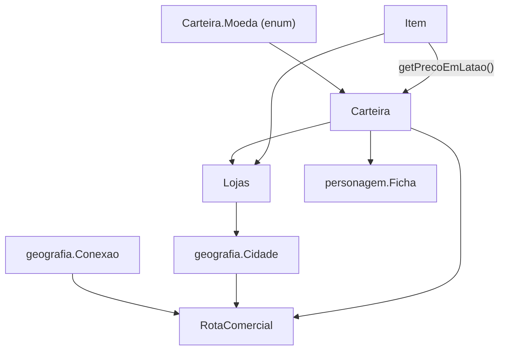

# 🪙 01. Base Monetária e Escala de Latão v2 — Thaluria

> Retornar ao [[Compêndio de Economia, Comércio e Crafting]]

Este documento descreve **todo o sistema econômico monetário implementado em Java** (pacote `economia`) e **tudo o que evoluiu** da v1 para a v2. A grande virada da v2 é a nova escala monetária canônica, com **10 moedas decimais e hierárquicas** em vez de apenas 3, e o cálculo de todas as grandezas em **Latão (`long`)**, a menor unidade indivisível do sistema.

> [!NOTE]
> Os preços de itens e os valores de API "em ouro" continuam sendo expressos em **moedas de ouro (PO)** como `double` para facilidade de leitura. Por baixo, tudo é convertido para **latão (`long`)**, garantindo precisão matemática absoluta sem arredondamento indesejado.

---

## 📑 Índice

1. [Visão geral da arquitetura](#1--visão-geral-da-arquitetura)
2. [Escala monetária](#2--escala-monetária)
3. [Carteira](#3--carteira)
4. [Item](#4--item)
5. [Lojas](#5--lojas)
6. [RotaComercial](#6--rotacomercial)
7. [Integrações (Ficha, Cidade, Conexao)](#7--integrações-com-outras-classes)
8. [O que mudou da v1 para a v2](#8--o-que-mudou-da-v1-para-a-v2)
9. [Guia de migração](#9--guia-de-migração)
10. [Limitações e pontos de atenção](#10--limitações-e-pontos-de-atenção)

---

## 1. 🧭 Visão geral da arquitetura



| Classe | Arquivo | Responsabilidade |
|---|---|---|
| `Carteira` (+ `Carteira.Moeda`) | [`Carteira.java`](../../src/economia/Carteira.java) | Saldo, moedas, pagamentos e conversões |
| `Item` | [`Item.java`](../../src/economia/Item.java) | Itens, preço (em PO), peso, tipo e raridade |
| `Lojas` | [`Lojas.java`](../../src/economia/Lojas.java) | Estoque, caixa e compra/venda de itens |
| `RotaComercial` | [`RotaComercial.java`](../../src/economia/RotaComercial.java) | Distância, perigo, frete e escolta de uma rota |

---

## 2. 🪙 Escala monetária

### 2.1 Conversões

```
1 édito    = 1000 talentos
1 talento  = 10 diamantes
1 diamante = 10 cobaltos
1 cobalto  = 10 platinas
1 platina  = 10 ouros
1 ouro     = 10 pratas
1 prata    = 10 cobres
1 cobre    = 10 ferros
1 ferro    = 10 latões
```

> [!IMPORTANT]
> O **édito** é a única moeda que **não** segue a razão 10: vale **1000** talentos (moeda imperial de reserva de tesouro).

### 2.2 Tabela de moedas

Do menor para o maior valor. A coluna "Valor em latão" é a unidade interna de todas as contas.

| Moeda | Constante (`Moeda`) | Sigla¹ | Valor em latão | Equivalente em ouro (PO) |
|---|---|---|---:|---:|
| Latão | `LATAO` | PL | 1 | 0,0001 |
| Ferro | `FERRO` | PF | 10 | 0,001 |
| Cobre | `COBRE` | PC | 100 | 0,01 |
| Prata | `PRATA` | PP | 1.000 | 0,1 |
| **Ouro** | `OURO` | **PO** | **10.000** | **1** |
| Platina | `PLATINA` | PT | 100.000 | 10 |
| Cobalto | `COBALTO` | CB | 1.000.000 | 100 |
| Diamante | `DIAMANTE` | DI | 10.000.000 | 1.000 |
| Talento | `TALENTO` | TL | 100.000.000 | 10.000 |
| Édito | `EDITO` | ED | 100.000.000.000 | 10.000.000 |

¹ As siglas PO, PP e PC já existiam na v1. As demais siglas (PL, PF, PT, CB, DI, TL, ED) foram definidas na implementação da v2 e operam nativamente no enum `Moeda`.

> [!TIP]
> Para adicionar ou renomear uma moeda, o ponto de partida é o enum `Carteira.Moeda`. O valor de cada moeda e as siglas residem nele. Como a Carteira guarda um campo por moeda, uma moeda nova também exige um campo, um case em `definirCampo`/`getQuantidade` e um getter.

---

## 3. 👛 Carteira

[`economia.Carteira`](../../src/economia/Carteira.java) guarda a quantidade de cada uma das 10 moedas e faz as operações financeiras.

### 3.1 Como funciona

- **Estado:** 10 campos `int` (`edito`, `talento`, `diamante`, `cobalto`, `platina`, `ouro`, `prata`, `cobre`, `ferro`, `latao`).
- **Cálculo:** o valor total é somado em **latão** (`long`). Depois de qualquer operação, o total é **redistribuído** (`distribuir`) da maior moeda para a menor.
- **Normalização automática:** a carteira fica sempre na forma mais compacta. Exemplo: 25 pratas viram `2 PO, 5 PP`.
- **Troco automático:** ao pagar, o valor total é subtraído e redistribuído. Pagar 3 PO com uma única platina deixa `7 PO`, sem precisar "quebrar" a moeda manualmente.
- **Sem valores negativos:** quantidades, valores a receber e valores de adição menores ou iguais a zero são ignorados. Pagamentos de valor negativo retornam `false`.

### 3.2 Construtores

| Construtor | Efeito |
|---|---|
| `Carteira()` | Carteira vazia |
| `Carteira(int ouro)` | Começa com o ouro informado |
| `Carteira(int ouro, int prata, int cobre)` | Soma e normaliza os três valores (negativos são ignorados) |

### 3.3 API pública

#### Operações de saldo

| Método | Descrição |
|---|---|
| `adicionar(Moeda, long)` | Adiciona uma quantidade de qualquer moeda |
| `adicionarOuro(int)` / `adicionarPrata(int)` / `adicionarCobre(int)` | Atalhos para as três moedas da v1 |
| `adicionarMoedas(int ouro, int prata, int cobre)` | Adiciona as três de uma vez |
| `receber(double valorEmOuro)` | Recebe um valor em PO (aceita fração, ex.: `12.345`) |
| `receberLatao(long)` | Recebe um valor exato em latão |
| `normalizarMoedas()` | Reagrupa todas as moedas na forma mais compacta |
| `setQuantidade(Moeda, int)` | Define a quantidade de uma moeda e normaliza |

#### Consultas e pagamentos

| Método | Descrição |
|---|---|
| `getValorTotalEmLatao()` | Saldo total exato (`long`) |
| `getValorTotalEmOuro()` | Saldo total em PO (`double`) |
| `temSaldo(double valorEmOuro)` / `temSaldoEmLatao(long)` | Verifica se há saldo suficiente |
| `pagar(double valorEmOuro)` / `pagarLatao(long)` | Debita o valor. Retorna `false`, sem debitar nada, se faltar saldo ou o valor for negativo |

#### Getters e setters

- `getQuantidade(Moeda)` e getters individuais: `getEdito()`, `getTalento()`, `getDiamante()`, `getCobalto()`, `getPlatina()`, `getOuro()`, `getPrata()`, `getCobre()`, `getFerro()`, `getLatao()`.
- Setters individuais, por compatibilidade com a v1: `setOuro`, `setPrata`, `setCobre`. Para as demais moedas, use `setQuantidade(Moeda, int)`.

#### Conversão e formatação (estáticos)

| Método | Descrição |
|---|---|
| `ouroParaLatao(double)` | PO → latão (arredonda para o latão mais próximo) |
| `lataoParaOuro(long)` | latão → PO |
| `deLatao(long)` | Cria uma `Carteira` com exatamente aquele valor |
| `formatarLatao(long)` | Descreve um valor em moedas. Ex.: `14600 → "1 PO, 4 PP, 6 PC"` |

#### Texto

- `descreverMoedas()` mostra só as moedas com quantidade maior que zero, da maior para a menor. Uma carteira vazia retorna `"0 PO"`.
- `toString()` devolve `descreverMoedas()` seguido do equivalente em ouro com 4 casas. Ex.: `1 PT, 4 PO, 5 PP (Equivalente: 14,5000 PO)`.

### 3.4 Exemplo

```java
Carteira c = new Carteira(5, 3, 7);   // 5 PO, 3 PP, 7 PC
c.receber(12.345);                     // + 12,345 PO
System.out.println(c);
// 1 PT, 7 PO, 7 PP, 1 PC, 5 PF (Equivalente: 17,7150 PO)

c.pagar(3.1234);                       // paga com troco automático
c.adicionar(Carteira.Moeda.TALENTO, 1500);
System.out.println(c);
// 1 ED, 500 TL, 1 PT, 4 PO, 5 PP, 9 PC, 1 PF, 6 PL (...)
```

---

## 4. 🎒 Item

[`economia.Item`](../../src/economia/Item.java) representa armas, armaduras, consumíveis e recursos.

- **Preço:** continua em **ouro (PO)**, como `double`. O mínimo é `0.0`.
- **Peso:** em kg.
- **Tipos** (`TipoItem`): Arma, Armadura, Escudo, Consumível, Acessório, Material de Forja, Item Mágico / Grimório e Geral.
- **Raridades** (`RaridadeItem`): Comum, Incomum, Raro, Épico e Lendário.

### Novidades da v2

| Método | Descrição |
|---|---|
| `getPrecoEmLatao()` | Preço unitário convertido para latão (`long`) |
| `getValorTotalEmLatao()` | Preço × quantidade, em latão |

O `toString()` agora mostra o preço **nas moedas do sistema**. Por exemplo, um item de 2,3456 PO aparece como `(2 PO, 3 PP, 4 PC, 5 PF, 6 PL, 0,5 kg)`.

---

## 5. 🏪 Lojas

[`economia.Lojas`](../../src/economia/Lojas.java) representa um estabelecimento comercial.

- **Dados:** nome, mercador, se é loja de rede (e o nome da rede), `estoque` (lista de `Item`) e `caixa` (uma `Carteira`).
- **Caixa inicial:** `50 PO`.
- **Estoque:** `adicionarItem` agrupa itens iguais e soma as quantidades. O mesmo vale para `removerItem` e `buscarItemPorNome`. `getEstoque()` é somente leitura.

### Transações

| Método | Fluxo |
|---|---|
| `venderItem(item, carteiraCliente)` | O cliente paga o preço do item (`pagarLatao`) → o valor entra no caixa (`receberLatao`) → o estoque diminui em 1. Retorna `false` se o item não estiver no estoque ou se o cliente não tiver saldo |
| `comprarItem(item, carteiraCliente, precoCompra)` | O caixa paga o cliente (`pagarLatao`) → o cliente recebe (`receberLatao`) → o item entra no estoque. Retorna `false` se o caixa não tiver saldo |

> [!IMPORTANT]
> Nas duas transações o valor é convertido para latão **uma única vez** e o mesmo número é debitado de um lado e creditado do outro. Assim, o total de moedas do sistema nunca muda numa compra ou venda.

---

## 6. 🚚 RotaComercial

[`economia.RotaComercial`](../../src/economia/RotaComercial.java) representa um percurso entre cidades e calcula os custos de transporte.

### 6.1 Dados da rota

Um objeto é criado com a lista ordenada de cidades e a lista de conexões ([`Conexao`](../../src/geografia/Conexao.java)) percorridas. Os indicadores são calculados na construção e não mudam depois.

| Indicador | Cálculo |
|---|---|
| `distanciaTotalKm` | Soma da distância de todas as conexões |
| `perigoMedio` | Média do perigo **ponderada pela distância**: `Σ(perigo × km) / Σ km` |
| `perigoMaximo` | Maior perigo entre as conexões (o "pior trecho") |

- As listas são copiadas na construção, e os getters devolvem **visões somente leitura**.
- Lista nula ou conexão nula lançam `IllegalArgumentException`.

### 6.2 Fórmulas de custo

Todas as contas são feitas em **latão** e arredondadas para o latão mais próximo.

| Custo | Fórmula | Base |
|---|---|---|
| **Frete** | `km × 200 × (1 + peso/50) × (1 + perigoMédio × 0,15)` | 2 PC (200 latão) por km |
| **Escolta** | `km × 500 × (1 + perigoMédio × 0,25)` | 5 PC (500 latão) por km |

- **Peso:** a cada 50 kg de carga, o fator de peso sobe em 1,0. Peso negativo conta como 0.
- **Risco:** o frete sobe 15% por nível de perigo médio, e a escolta sobe 25%.
- **Escolta recomendada** (`recomendaEscolta()`): quando o **perigo médio ≥ 4,0** ou o **perigo máximo ≥ 6**.

### 6.3 API pública

| Método | Retorno |
|---|---|
| `calcularCustoFreteEmLatao(double pesoKg)` | `long`, valor exato |
| `calcularCustoFrete(double pesoKg)` | `double`, em PO |
| `calcularCustoEscoltaEmLatao()` | `long`, valor exato |
| `calcularCustoEscolta()` | `double`, em PO |
| `descreverCustoFrete(double pesoKg)` / `descreverCustoEscolta()` | `String` nas moedas do sistema |
| `pagarFrete(Carteira, double pesoKg)` / `pagarEscolta(Carteira)` | `boolean`; debita da carteira. Retorna `false`, sem debitar nada, se a carteira for nula ou não tiver saldo |
| `recomendaEscolta()` | `boolean` |
| `getCaminhoCidades()`, `getArestas()`, `getDistanciaTotalKm()`, `getPerigoMedio()`, `getPerigoMaximo()` | Getters |

### 6.4 Exemplo resolvido

Rota A → B → C:

| Trecho | Distância | Perigo |
|---|---:|---:|
| A → B | 100 km | 2 |
| B → C | 300 km | 6 |

- Distância total: **400 km**.
- Perigo médio: (100×2 + 300×6) / 400 = **5,0**.
- Perigo máximo: **6**.
- **Frete** de 100 kg: 400 × 200 × (1 + 100/50) × (1 + 5,0 × 0,15) = 400 × 200 × 3 × 1,75 = **420.000 latão = 42 PO = `4 PT, 2 PO`**.
- **Escolta:** 400 × 500 × (1 + 5,0 × 0,25) = **450.000 latão = 45 PO = `4 PT, 5 PO`**.
- `recomendaEscolta()` retorna `true`: o perigo médio (5,0) é maior que 4,0 e o perigo máximo (6) atinge o limite de 6. Qualquer uma das duas condições já bastaria.

```java
RotaComercial rota = new RotaComercial(cidades, conexoes);
System.out.println(rota.descreverCustoFrete(100));   // "4 PT, 2 PO"

Carteira viajante = new Carteira(100);               // 100 PO
if (rota.pagarFrete(viajante, 100) && rota.recomendaEscolta()) {
    rota.pagarEscolta(viajante);
}
System.out.println(viajante);                        // 1 PT, 3 PO (13 PO)
```

---

## 7. 🔗 Integrações com outras classes

| Classe | Uso da economia |
|---|---|
| [`personagem.Ficha`](../../src/personagem/Ficha.java) | Cada personagem tem uma `Carteira` (`getCarteira()` / `setCarteira()`), criada vazia |
| [`geografia.Cidade`](../../src/geografia/Cidade.java) | Mantém uma lista de `Lojas` (`adicionarLoja`, `removerLoja`, `getLojas`) |
| [`geografia.Conexao`](../../src/geografia/Conexao.java) | Fonte de distância e perigo da `RotaComercial`. O perigo pode ser alterado com `ajustarPerigo(int delta)` (mantido entre 1 e 10). Como os indicadores da rota são calculados na criação, **uma rota existente não acompanha** mudanças posteriores na conexão |

---

## 8. 🔄 O que mudou da v1 para a v2

### 8.1 Resumo

| Área | v1 | v2 |
|---|---|---|
| Moedas | 3 (ouro, prata, cobre) | **10** (de latão a édito) |
| Unidade interna | cobre (`int`) | **latão** (`long`) |
| Escala base | 1 PO = 10 PP = 100 PC | **Mantida** (1 PO = 10 PP = 100 PC), agora estendida |
| Pagamento | só em PO (`double`) | PO (`double`) **e** latão (`long`) |
| Normalização | só cobre → prata → ouro | Todas as 10 moedas |
| Formato de preços | `%.2f PO` | Moedas do sistema (`4 PT, 2 PO`) |

### 8.2 Por classe

#### `Carteira` (reescrita)
- ➕ Enum `Moeda` e os campos das 10 moedas.
- ➕ `adicionar(Moeda, long)`, `getQuantidade(Moeda)`, `setQuantidade(Moeda, int)` e os getters das novas moedas.
- ➕ `receber(double)`, `receberLatao(long)`, `pagarLatao(long)` e `temSaldoEmLatao(long)`.
- ➕ `ouroParaLatao`, `lataoParaOuro`, `deLatao` e `formatarLatao`, todos estáticos.
- ➕ `descreverMoedas()`.
- 🔁 `pagar`, `temSaldo`, `adicionar*` e `normalizarMoedas` agora usam todas as moedas, via latão.
- 🔁 `toString()` mostra só as moedas presentes e o equivalente em ouro com 4 casas.
- ❌ **Removido:** `getValorTotalEmCobre()`. Use `getValorTotalEmLatao()` (1 cobre = 100 latão).
- 🔧 Campo `Edito` renomeado para `edito`.

#### `Item`
- ➕ `getPrecoEmLatao()` e `getValorTotalEmLatao()`.
- 🔁 `toString()` exibe o preço nas moedas do sistema.

#### `Lojas`
- 🐛 **Correção de bug:** na v1, `venderItem` e `comprarItem` convertiam o preço com `(int) preco`, descartando prata e cobre. Um item de 2,5 PO só colocava 2 PO no caixa.
- 🔁 Agora as transações usam latão e são exatas.

#### `RotaComercial` (nova)
- ➕ Classe criada na v2, no pacote `economia`.
- ➕ Cálculo de frete, escolta e recomendação de escolta, **já na escala nova**.
- 🔁 Os custos eram arredondados para 0,01 PO. Agora são exatos até 1 latão (0,0001 PO).

#### `Conexao` (geografia)
- ➕ `ajustarPerigo(int)`. O campo `perigo` deixou de ser `final`.

---

## 9. 🧰 Guia de migração

| Se o seu código usava... | Passe a usar... |
|---|---|
| `carteira.getValorTotalEmCobre()` | `carteira.getValorTotalEmLatao() / 100` (ou `getValorTotalEmLatao()` direto) |
| `lojas.caixa.adicionarMoedas((int) preco, 0, 0)` | `caixa.receber(preco)` ou `caixa.receberLatao(...)` |
| `carteira.adicionarOuro((int) valorFracionado)` | `carteira.receber(valorFracionado)` |
| `String.format("%.2f PO", item.getPreco())` | `Carteira.formatarLatao(item.getPrecoEmLatao())` |
| Contas com `double` em ouro | `...EmLatao()` e `pagarLatao(...)`, que evitam erros de ponto flutuante |

Os métodos `pagar(double)`, `temSaldo(double)`, `adicionarOuro/Prata/Cobre`, `adicionarMoedas` e `getOuro/getPrata/getCobre` continuam funcionando como antes.

---

## 10. ⚠️ Limitações e pontos de atenção

- **Limite por moeda:** cada campo é um `int`. Se um valor ultrapassar `Integer.MAX_VALUE` (~2,1 bilhões) em uma moeda, ele é truncado. Na prática, só o édito, a maior moeda, chega perto disso.
- **Precisão de `double`:** `ouroParaLatao` arredonda `valor × 10.000` para o latão mais próximo. Para valores muito grandes ou com muitas casas decimais, prefira trabalhar direto em latão.
- **`pagar(0)`** retorna `true` e não altera a carteira.
- **Siglas das moedas novas** (PL, PF, PT, CB, DI, TL, ED) foram definidas na implementação e compõem o padrão canônico de exibição.
- **Rotas são "fotografias":** os indicadores de `RotaComercial` são calculados na criação. Se o perigo de uma `Conexao` mudar depois, o `NavegadorGrafo` gera uma nova `RotaComercial`.
- **Garantia de Qualidade:** Todas as conversões e regras monetárias da escala de Latão são auditadas pela suíte automatizada [`TesteEndToEnd.java`](../../src/teste/TesteEndToEnd.java) (69 testes).

---
> Retornar ao [[Compêndio de Economia, Comércio e Crafting]]
