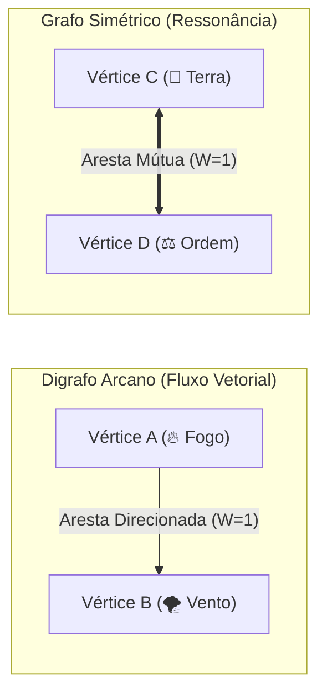

# 🧠 01. Fundamentos e Limite Mental da Grafiturgia

A **Grafiturgia Elemental** é a ciência arcana fundamental de Thaluria que estuda a materialização de feitiços através de redes de energia. Em vez de palavras arcanas estáticas, o conjurador projeta mentalmente uma malha geométrica etérea — um **Grafo Arcano** — onde a Mana flui para alterar a realidade.

---

## 1. Anatomia de um Grafo Arcano

Toda magia é composta estritamente por três entidades matemáticas e místicas:

1. **Vértices ($V$ - Os Nós Elementais):**
* São pontos focais onde a essência elemental é ancorada na realidade através da mente do conjurador.
* Cada vértice representa uma carga de um elemento primordial (ex: Fogo, Gelo, Caos, Ordem).
* O número total de vértices ($|V|$) define a **complexidade estrutural** e a **quantidade base de dados de impacto** do feitiço.

2. **Arestas ($E$ - Os Canais de Condução):**
* São os filamentos de mana que unem dois vértices elementais. O número total de arestas ($|E|$) dita a **densidade e rigidez** da magia.
* **Arestas Direcionadas ($A \rightarrow B$ - Digrafos):** Usadas em magias de ataque, disparo, explosão e maldição. A energia possui um vetor de fluxo claro (do nó de *Ignição* até o nó de *Impacto*). O peso $W$ é consultado na linha do elemento de origem ($A$) para o destino ($B$).
* **Arestas Não-Direcionadas ($A \leftrightarrow B$ - Grafos Simétricos):** Usadas em barreiras, escudos e selos estáticos. A energia ressoa nos dois sentidos simultaneamente para distribuir tensão. Se a afinidade entre $A \rightarrow B$ e $B \rightarrow A$ for assimétrica na Matriz, prevalece sempre o **maior peso ($W$)** entre os dois sentidos.

3. **Pesos de Resistência ($W$ - Impedância Mágica):**
* Cada aresta possui um custo de atrito intrínseco ($W$), medido pela afinidade natural entre os dois elementos interligados.
* Conexões harmônicas fluem livremente ($W=1$), conexões neutras sofrem resistência ($W=2$) e conexões antagônicas colapsam ($W=\infty$).
* A soma de todos os pesos ($\sum W$) dita o gasto metabólico de [[Status#Malha de Recursos e Defesas|Mana]].

---

## 2. A Capacidade Mental Cognitiva ($|V|$)

Manter nós elementais ativos no éter exige processamento lógico contínuo. Essa capacidade está atrelada diretamente ao atributo **Mental (MEN)** e ao seu **Grau (Tier)**:

$$\text{Limite de Vértices Estáveis} = 2 + \text{Grau}_{\text{MEN}}$$

> [!NOTE]
> Conforme definido nas regras de [[Status#Escala de Níveis e Graus (Tiers)|Status]], o **Grau** equivale à dezena do atributo:
> * `0 a 9 em MEN` $\rightarrow$ **Grau 0** (Capacidade: **2 Vértices**)
> * `10 a 19 em MEN` $\rightarrow$ **Grau 1** (Capacidade: **3 Vértices**)
> * `20 a 29 em MEN` $\rightarrow$ **Grau 2** (Capacidade: **4 Vértices**)
> * `30 a 39 em MEN` $\rightarrow$ **Grau 3** (Capacidade: **5 Vértices**)
> * `50 a 59 em MEN` $\rightarrow$ **Grau 5** (Capacidade: **7 Vértices**)
> * `100 em MEN` $\rightarrow$ **Grau 10** (Capacidade: **12 Vértices Máximos**)

---

## 3. Sobrecarga e Conexão Forçada

O que acontece se um conjurador tentar desenhar mais vértices do que seu limite mental comporta?

* **Estabilidade Natural ($|V| \le 2 + \text{Grau}_{\text{MEN}}$):** O feitiço é conjurado sem risco mental, consumindo apenas a Mana necessária.
* **Sobrecarga Neural ($|V| > 2 + \text{Grau}_{\text{MEN}}$):** A mente do conjurador começa a superaquecer. Para cada turno em que a magia for sustentada ou disparada, o conjurador deve realizar um teste obrigatório de **Ocultismo/Arcanismo**:

$$\text{DT de Sobrecarga} = 10 + (5 \times |V|) + \left(2 \times \sum W\right)$$

* Em caso de falha, o feitiço sofre **Colapso de Grafo**, queimando a Sanidade (SAN) e ferindo o próprio conjurador (consulte [[04 - Protocolo do Mestre e Colapso de Grafo]]).

---

## 4. Próximos Passos
* Para entender a condutividade e afinidade entre cada elemento, leia: [[02 - Matriz Elemental e Regra das Pontes]].
* Para dominar as geometrias e formatos de dispersão, leia: [[03 - Topologias e Geometria dos Feitiços]].
