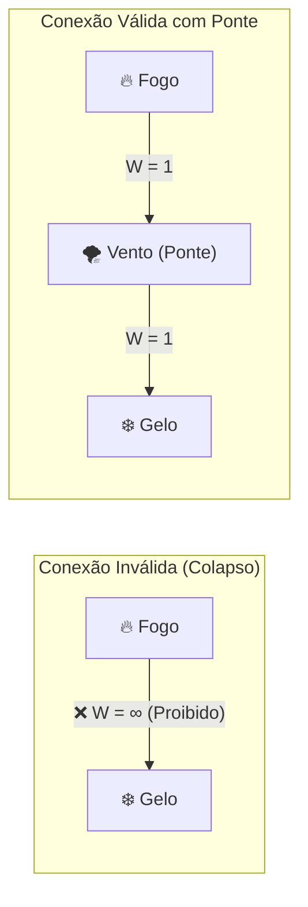

# 🧪 02. Matriz Elemental e Regra das Pontes

Em Thaluria, a Mana primordial se decompõe em **10 Essências Elementais**. Cada elemento possui polaridades de atração e repulsão que governam a impedância de energia entre os vértices de um grafo mágico.

---

## 1. Classificação das Essências Elementais

Os 10 elementos se dividem em três grandes naturezas de impacto nos [[Status#Malha de Recursos e Defesas|Recursos]]:

1. **Essências Físico-Elementais (Foco: HP):**
   * **🔥 Fogo (Ignis):** Expansão térmica, combustão e dano destrutivo direto.
   * **💧 Água (Aqua):** Fluidez, purificação, dispersão e condutividade biológica.
   * **🌱 Terra (Terra):** Densidade, massa, ancoragem física e impacto contundente.
   * **🌪️ Vento (Aer):** Cinética, corte aerodinâmico, aceleração e alcance.
   * **⚡ Raio (Fulmen):** Alta voltagem, velocidade instantânea e penetração de armadura.
   * **❄️ Gelo (Glacies):** Retração molecular, cristalização e redução de mobilidade.

2. **Essências Híbridas / Ocultas (Foco: HP ou SAN):**
   * **☀️ Luz (Lux):** Radiação celestial, revelação e queima de impurezas.
   * **🌑 Sombra (Umbra):** Obscuridade etérea, frio espiritual e corrosão de vitalidade/psique.

3. **Essências Psíquico-Estruturais (Foco: SAN ou Malha):**
   * **👁️ Caos (Psicose):** Distorção entrópica, delírio e ataque direto à Sanidade (SAN).
   * **⚖️ Ordem (Vetor):** Geometria neutra, estabilização de fluxos e contenção estrutural.

---

## 2. A Matriz de Adjacência e Pesos de Resistência ($W$)

A conexão entre dois vértices calcula a impedância mágica daquela aresta:

* **Conexão Harmônica ($W = 1$):** Fluxo perfeitamente compatível. Custo base de Mana.
* **Conexão Neutra ou Autofluxo ($W = 2$):** Atrito mágico moderado (inclusive ligar nós do mesmo elemento, ex: `Fogo` $\rightarrow$ `Fogo`). Dobra o custo da aresta.
* **Conexão Oposta ($W = \infty$ / Proibida):** Antagonismo violento. **Proibido ligar diretamente.** Tentar unir opostos sem uma ponte causa *Inversão de Feitiço*.

| Vértice Elemental | Natureza do Alvo | Harmônicos ($W=1$) | Neutros ($W=2$) | Opostos Diretos ($W=\infty$) |
| :--- | :--- | :--- | :--- | :--- |
| **🔥 Fogo (Ignis)** | Elemental $\rightarrow$ **HP** | Vento, Raio, Caos | Fogo, Terra, Luz, Sombra | **Água, Gelo** |
| **💧 Água (Aqua)** | Elemental $\rightarrow$ **HP** | Gelo, Terra, Ordem | Água, Vento, Raio, Luz | **Fogo, Raio\*** |
| **🌱 Terra (Terra)** | Elemental $\rightarrow$ **HP** | Água, Fogo, Ordem | Terra, Gelo, Luz, Sombra | **Vento, Raio** |
| **🌪️ Vento (Aer)** | Elemental $\rightarrow$ **HP** | Fogo, Raio, Gelo | Vento, Água, Caos, Luz | **Terra, Ordem** |
| **⚡ Raio (Fulmen)** | Elemental $\rightarrow$ **HP** | Fogo, Vento, Água | Raio, Luz, Caos, Ordem | **Terra** |
| **❄️ Gelo (Glacies)** | Elemental $\rightarrow$ **HP** | Água, Vento, Ordem | Gelo, Terra, Sombra | **Fogo, Caos** |
| **☀️ Luz (Lux)** | Elemental / Oculto $\rightarrow$ **HP** | Fogo, Raio, Ordem | Luz, Água, Terra, Vento | **Sombra, Caos** |
| **🌑 Sombra (Umbra)** | Oculto / Psíquico $\rightarrow$ **HP / SAN** | Gelo, Caos | Sombra, Terra, Fogo, Água | **Luz, Ordem** |
| **👁️ Caos (Psicose)** | Psíquico $\rightarrow$ **SAN** | Fogo, Sombra | Caos, Vento, Raio | **Ordem, Gelo, Luz** |
| **⚖️ Ordem (Vetor)** | Mental / Neutro _(Estrutural)_ | Água, Terra, Gelo, Luz | Ordem, Raio, Fogo, Sombra | **Caos, Vento** |

> [!NOTE]
> **\*Exceção Condutiva (Água vs Raio):** Água destilada purificada resiste ao raio, mas a água mundana dissipa a eletricidade de forma caótica. Na matriz canônica pura, uma conexão direta entre Água e Raio sem Ordem ou Vento intermediário gera instabilidade.

---

## 3. A Lei do Vértice Ponte (Como Unir Elementos Opostos)

É possível criar uma magia que misture **Fogo** e **Gelo** (ou **Luz** e **Sombra**)? **Sim, mas nunca através de uma aresta direta!**

Para misturar elementos opostos, o conjurador deve obrigatoriamente inserir um **Vértice Ponte** que seja neutro ou harmônico com ambos os lados:

### Análise da Solução com Ponte:
1. `Fogo` $\rightarrow$ `Gelo` diretamente = **Proibido** ($W = \infty$).
2. Ao inserir o `Vento` como vértice intermediário:
   * Aresta `Fogo` $\leftrightarrow$ `Vento`: Harmônica ($W = 1$).
   * Aresta `Vento` $\leftrightarrow$ `Gelo`: Harmônica ($W = 1$).
   * **Resultado:** Feitiço perfeitamente estável! O vento age como meio gasoso que isola termicamente as duas fases, permitindo conjurar um projétil de *Nevasca Incandescente* com peso total $\sum W = 2$.

---

## 4. Próximos Passos
* Para ver como organizar essas conexões em formas de projétil, área ou escudo, leia: [[03 - Topologias e Geometria dos Feitiços]].
* Para ver os cálculos de custo em Mana decorrentes dos pesos, leia: [[04 - Protocolo do Mestre e Colapso de Grafo]].
