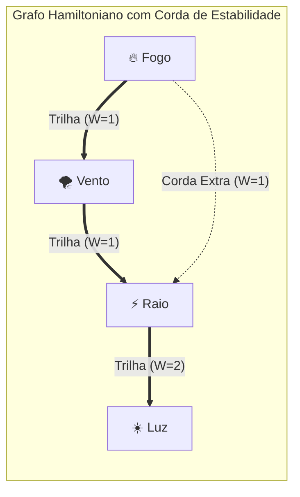
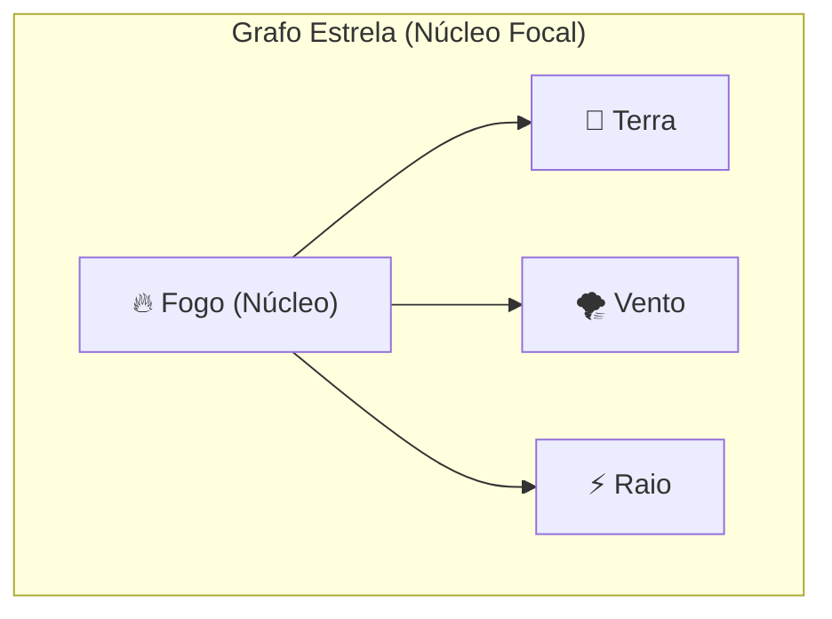
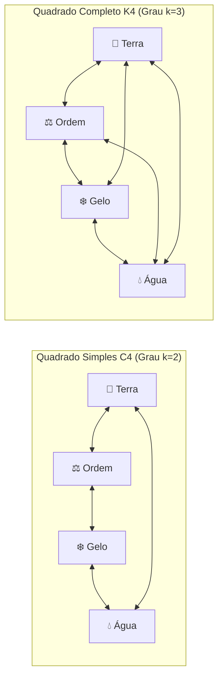
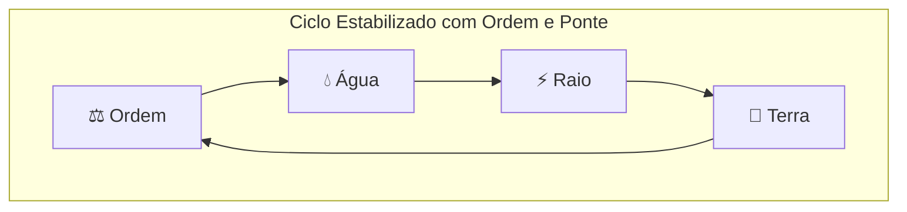

# 📐 03. Topologias e Geometria dos Feitiços

Na Grafiturgia Elemental de Thaluria, a **forma geométrica do grafo** atua como uma lente focalizadora: ela determina **como a energia é liberada no espaço físico**. Um mago não pode simplesmente querer uma explosão em área usando uma cadeia linear de disparo — a geometria precisa espelhar a física do efeito desejado.

Existem **4 grandes topologias canônicas**:

---

## 1. Disparo / Projétil / Golpe Único (Caminho ou Ciclo Hamiltoniano)

Quando a intenção é desferir um impacto perfurante, concentrado ou balístico contra um alvo único, a energia principal deve fluir por uma trilha sequencial que visite todos os nós.

* **Definição de Grafo:** Qualquer digrafo que contenha um **Caminho ou Ciclo Hamiltoniano** (uma trilha direcionada principal que passa por todos os $|V|$ vértices exatamente uma vez).
* **Propriedade Arcana:** Aceleração linear contínua. O primeiro vértice da trilha é a **Ignição** (forma de lançamento) e o último é o **Payload** (descarga final no alvo).
* **Sub-rotinas de Corda (Arestas Extras / Bifurcações no Grafo):**
Um grafo hamiltoniano **pode possuir arestas extras (Cordas)** conectando vértices não-adjacentes da trilha principal (ex: ligar $V_1 \rightarrow V_3$ enquanto a trilha faz $V_1 \rightarrow V_2 \rightarrow V_3 \rightarrow V_4$). O fluxo principal não desvia por elas, mas usa essas pontes como tensores balísticos:
* **Bônus de Corda ($\Delta E$):** Cada aresta extra fora da trilha hamiltoniana concede **$+2$ de Penetração de Defesa/Armadura** e **$+1d4$ de dano adicional** ao disparo.

* **Bônus de Ciclo Hamiltoniano Fechado:**
Se o conjurador conectar o último nó da trilha de volta ao primeiro ($V_n \rightarrow V_1$) mantendo ligações válidas, a energia entra em acelerador de partículas circular antes do disparo:

$$\text{Bônus de Ciclo Fechado} = +(5 \times \text{Grau}_{\text{magia}})$$

---

## 2. Explosão / Magia em Área - AoE (Grafo Estrela ou Grafo Euleriano)

Quando a intenção é detonar uma onda de choque, tempestade ou erupção que atinja múltiplos alvos simultaneamente em um raio ao redor de um ponto.

* **Definição de Grafo:**
* **Grafo Estrela ($S_n$):** Um **nó central focal** que dispara radialmente para múltiplos nós periféricos satélites.
* **Grafo Euleriano:** Grafo conexo onde o fluxo percorre **todas as arestas** exatamente uma vez (em circuito fechado quando todos os vértices têm grau par), gerando máxima saturação de área.

* **Propriedade Arcana:** O núcleo central consome e converte a mana, expelindo as essências periféricas em 360 graus.
* **Bônus de Saturação Euleriana:** Se uma magia de área for desenhada como um **Circuito Euleriano Fechado** (passando por todas as arestas sem repetir), o raio da explosão aumenta em **+3 metros** e a DT para esquivar sobe em **$+2 \times \text{Grau}_{\text{magia}}$**.

---

## 3. Barreira / Escudo / Armadura (Grafo $k$-Regular Simétrico)

Quando a intenção é reter impacto, bloquear golpes corporais ou repelir feitiços externos.

* **Definição de Grafo:** Grafo não-direcionado onde **todos os vértices possuem exatamente o mesmo grau $k$ de conexões** ($k$-regular).
* *Exemplos:* Triângulo $K_3$ ($|V|=3, k=2$); Quadrado em anel $C_4$ ($|V|=4, k=2$); Tetraedro/Quadrado com diagonais $K_4$ ($|V|=4, k=3$).

* **Propriedade Arcana (Lei da Rigidez de Grau $k$):** Quanto maior o grau $k$ de conexões por vértice, mais indeformável é a malha geométrica. Um quadrado de grau 2 ($C_4$) amassa sob pressão; um quadrado de grau 3 com diagonais cruzadas ($K_4$) trava os vetores de força em todas as direções.
* **Fórmula de Absorção e Redução de Dano (RD):**

$$\text{HP da Barreira} = (5 \times |V|) + (5 \times k \times \text{Grau}_{\text{magia}})$$

$$\text{Redução de Dano Fixa (RD)} = k \times \text{Grau}_{\text{magia}}$$

*(Nota: Um escudo de Grau $k=3$ exige mais arestas e Mana, mas reduz mais dano por golpe recebido e possui muito mais integridade estrutural que um de Grau $k=2$!)*

---

## 4. Efeito Contínuo / Maldição / Controle (Árvore ou Ciclo com Ordem)

Quando a intenção é impor uma condição duradoura (sangramento etéreo, lentidão, queima por turno, paralisia psíquica) ou invocar uma armadilha persistente.

* **Definição de Grafo:**
* **Árvore (Digrafo Ramificado Acíclico):** Fluxo que se enraíza no alvo e se bifurca em folhas sem fechar loops, infectando múltiplos sistemas da anatomia do oponente. Cada **folha terminal** (vértice de grau de saída 0) aplica um sintoma secundário.
* **Ciclo Direcionado com Nó de Ordem (⚖️):** O ciclo mantém a mana girando por múltiplos turnos. O nó de **Ordem** atua como válvula de retenção temporal, sustentando a duração por **$1 + k_{\text{Ordem}}$ turnos** sem custo adicional de manutenção.

---

## 5. Resumo Topológico Comparativo

| Intenção Tática | Topologia Canônica | Mecânica de Densidade ($|E|$ / Grau $k$) | Exemplo de Aplicação |
| :--- | :--- | :--- | :--- |
| **Disparo / Perfuração** | Grafo Hamiltoniano | Cada **Corda Extra** dá $+2$ Penetração e $+1d4$ dano | Projétil de Gelo, Lança de Luz |
| **Explosão / Raio (AoE)** | Estrela ($S_n$) / Euleriano | Circuito Euleriano amplia área em $+3\text{m}$ e $+2$ DT | Bola de Fogo, Pulso Sísmico |
| **Defesa / Bloqueio** | Grafo $k$-Regular ($C_n, K_n$) | Grau $k$ multiplica o HP da barreira e concede RD fixa | Escudo $C_4$ ($k=2$), Cúpula $K_4$ ($k=3$) |
| **Maldição / Condição** | Árvore / Ciclo com Ordem | Folhas ditam sintomas; Ordem sustenta turnos ativos | Veneno de Alma, Gaiola Gravitacional |

---

## 6. Próximos Passos
* Para ver como o Mestre avalia essas formas e calcula custos de mana, leia: [[04 - Protocolo do Mestre e Colapso de Grafo]].
* Para conferir magias prontas construídas em cada topologia, leia: [[05 - Grimório Prático e Exemplos Compilados]].
* Para técnicas de compressão de ciclos e contra-mágica avançada, leia: [[06 - Metamagia e Operações Avançadas de Grafo]].
