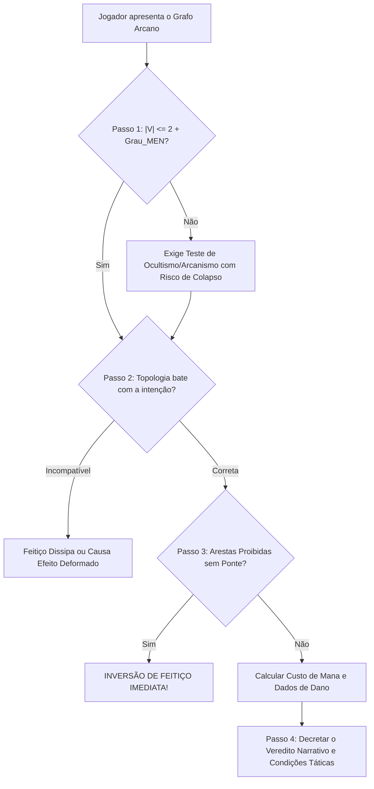

# ⚖️ 04. Protocolo do Mestre e Colapso de Grafo

Este documento estabelece o algoritmo passo a passo utilizado pelo Mestre para **"compilar"** e arbitrar qualquer feitiço criado pelos jogadores, bem como as consequências catastróficas de falha neural ou violação das leis elementais.

---

## 1. O Algoritmo de Compilação (4 Passos Rápidos)

Quando o jogador apresenta o desenho de um grafo para registrar no grimório ou conjurar em combate, execute esta verificação sequencial:

---

### 🔹 Passo 1: Checagem do Limite Mental
* **Ação:** Conte o número de vértices ($|V|$).
* **Fórmula de Suporte Estável:**
  $$|V| \le 2 + \text{Grau}_{\text{MEN}}$$
* **Resolução:**
  * Se estiver dentro do limite: A estrutura é cognitivamente estável. Prossiga sem rolagem adicional.
  * Se ultrapassar: O jogador é obrigado a rolar um teste de **Ocultismo/Arcanismo** para cada conjuração:
    $$\text{DT} = 10 + (5 \times |V|) + \left(2 \times \sum W\right)$$

---

### 🔹 Passo 2: Validação da Topologia
* **Ação:** Compare o formato geométrico desenhado com a intenção tática declarada:
  1. *Disparo / Projétil / Foco Único:* Exige **Caminho ou Ciclo Hamiltoniano**.
  2. *Explosão / Impacto em Área (AoE):* Exige **Grafo Estrela** ou **Grafo Euleriano**.
  3. *Barreira / Escudo / Armadura:* Exige **Grafo Regular / Simétrico** ($K_3, K_4, \dots$).
  4. *Maldição / Dano Periódico / Controle:* Exige **Árvore Ramificada** ou **Ciclo com Ordem (⚖️)**.
* **Resolução:** Se o jogador desenhou uma linha (Hamiltoniana) mas quer explodir uma sala, a magia não espalha; o Mestre corrige o efeito para um tiro perfurante pontual.

---

### 🔹 Passo 3: Verificação de Arestas e Cálculos Matemáticos
1. **Inspeção de Antagonismo e Direcionalidade:**
   * Verifique cada linha traçada contra a [[02 - Matriz Elemental e Regra das Pontes]].
   * Em **Digrafos (Ataques/Maldições)**, olhe a linha do vértice de *Origem* para a coluna do vértice de *Destino*. Em **Grafos Não-Direcionados (Escudos)**, aplique o maior peso entre $A \rightarrow B$ e $B \rightarrow A$.
   * Se houver dois elementos opostos ($W=\infty$) ligados diretamente sem um vértice ponte intermediário, o feitiço **não compila** (causa **Inversão de Feitiço** se forçado).
2. **Cálculo de Impacto Ofensivo ($D$):**
   * **Dados Base pelos Vértices:** $D_{\text{base}} = |V| \text{ dados}$ (calibre definido pelo Grau, ex: $d6, d8, d10$).
   * **Bônus de Densidade / Cordas ($\Delta E$):** Para cada aresta válida além da trilha mínima ($|E| > |V| - 1$ em caminhos abertos, ou cordas internas em ciclos), adicione **$+1d4$ de dano** e **$+2$ de Penetração de Defesa**.
   * **Bônus de Ciclo Hamiltoniano Fechado:** Se a trilha principal fechar um ciclo perfeito, some $+ (5 \times \text{Grau}_{\text{magia}})$ ao dano final.
3. **Cálculo de Integridade Defensiva (Barreiras $k$-Regulares):**
   * $\text{HP da Barreira} = (5 \times |V|) + (5 \times k \times \text{Grau}_{\text{magia}})$
   * $\text{Redução de Dano (RD)} = k \times \text{Grau}_{\text{magia}}$ *(onde $k$ é o número de arestas conectadas a cada vértice).*
4. **Cálculo de Mana:**
   $$\text{Custo de Mana} = \left(\sum W\right) \times 2 \times \text{Grau}_{\text{magia}}$$

---

### 🔹 Passo 4: O Veredito do Mestre
O Mestre combina a natureza dos elementos e o fluxo do grafo para definir o efeito descritivo e as condições táticas (ex: queimadura, congelamento, empurrão, queda, cegueira, lentidão).

---

## 2. A Tabela de Colapso de Grafo e Inversão de Feitiço

Quando um conjurador falha no teste de sobrecarga mental ou tenta ligar elementos antagônicos proibidos, a rede mágica sofre colapso reverso.

| Gravidade da Falha | Consequência Mecânica | Impacto Narrativo |
| :--- | :--- | :--- |
| **Falha Leve (por 1 a 4)** | Gasta a Mana normalmente. Sofre dano no HP igual a $\sum W$ por fricção de éter. | As linhas do grafo tremem e faíscam. O conjurador sofre pequenas queimaduras nas mãos, mas o feitiço ainda se manifesta fracamente (metade do dano). |
| **Falha Grave (por 5 a 9)** | O feitiço se desfaz no ar. O conjurador perde a ação do turno e sofre dano direto em [[Status#Malha de Recursos e Defesas|Sanidade (SAN)]] igual a $2 \times \|V\|$. | A geometria mental racha. Uma enxaqueca lancinante e sangramento nasal paralisam o conjurador por 1 turno completo. |
| **Falha Crítica (10+ ou 1 Natural)** | **Colapso Catastrófico de Grafo.** A mana total do feitiço é queimada; o conjurador sofre dano total no HP e perde $1d6$ de SAN permanente até o próximo descanso longo. | O grafo explode na face do mago. A mana estilhaça o foco arcano e projeta o conjurador contra a parede. |
| **Inversão de Feitiço (Ligação Proibida Direta)** | O feitiço atinge o **próprio conjurador** como se ele fosse o alvo final, com dano dobrado e sem direito a Defesa Oculta. | Os polos elementais antagônicos entram em curto-circuito dimensional. A energia colapsa para dentro do núcleo espiritual do mago. |

---

## 3. Próximos Passos
* Para ver feitiços completos compilados segundo este protocolo, leia: [[05 - Grimório Prático e Exemplos Compilados]].
* Para registrar seus próprios feitiços no formato padrão, utilize a: [[Ficha de Cadastro de Magia (Grafo Arcano)]].
