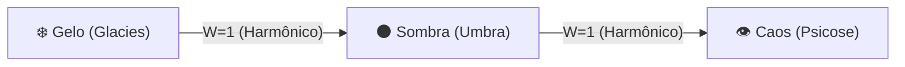
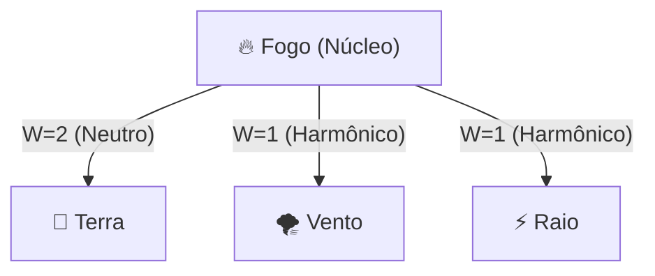
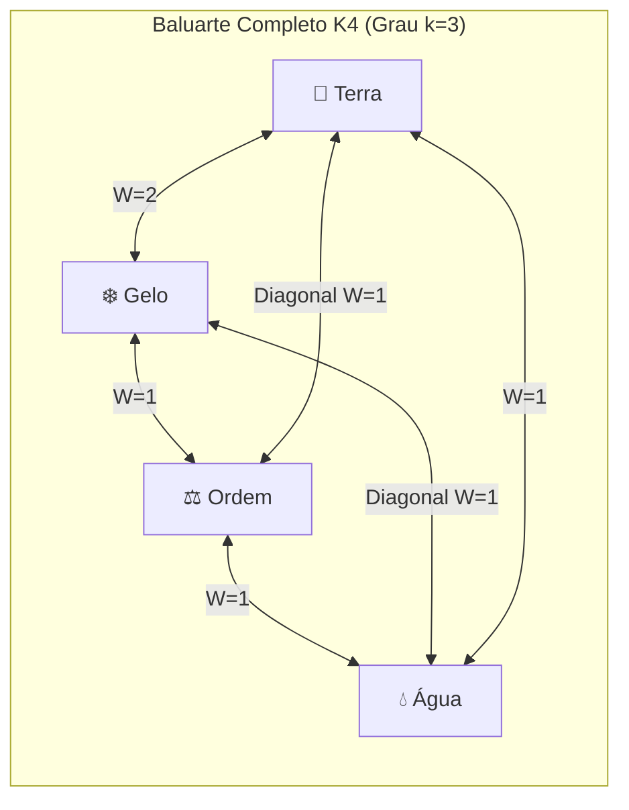
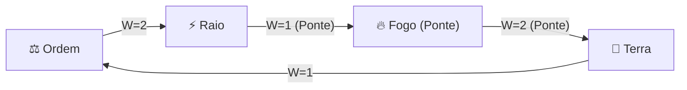

# 📖 05. Grimório Prático e Exemplos Compilados

Este documento apresenta **4 feitiços completos de referência**, demonstrando a aplicação prática da [[01 - Fundamentos e Limite Mental|Grafiturgia Elemental]], da [[02 - Matriz Elemental e Regra das Pontes|Matriz de Adjacência]] e das [[03 - Topologias e Geometria dos Feitiços|Topologias Canônicas]].

---

## ❄️ 1. Lança do Eclipse Gélido
* **Arquétipo Tático:** Disparo Perfurante Anti-Psique (Alvo Único a Longa Distância).
* **Topologia:** Caminho Hamiltoniano Aberto (3 Vértices, 2 Arestas).

### Ficha de Compilação:
* **Vértices ($|V|$):** 3 nós (`Gelo`, `Sombra`, `Caos`).
  * *Requisito Mental:* Mínimo Grau 1 de Mental ($3 \le 2 + 1$).
* **Arestas e Pesos ($\sum W$):**
  * `Gelo` $\rightarrow$ `Sombra`: Harmônico ($W = 1$).
  * `Sombra` $\rightarrow$ `Caos`: Harmônico ($W = 1$).
  * *Soma dos Pesos:* $\sum W = 2$.
* **Custo de Mana (Grau 1):** $\left(\sum W\right) \times 2 \times G = 2 \times 2 \times 1 = \mathbf{4\text{ Mana}}$.
* **Dados de Dano:** $|V| = 3\text{ dados}$ ($1d6$ de Gelo no HP + $2d6$ de Sombra/Caos direto na SAN).
* **Veredito do Mestre:**
  > *"O conjurador estende a mão e materializa uma espícula gélida de obsidiana translúcida que absorve a luz ao seu redor. Ao disparar, a agulha perfura o alvo sem emitir som. A vítima sofre $1d6$ de dano de gelo penetrante no HP e $2d6$ de dano psíquico direto na Sanidade (SAN), sentindo sua mente congelar em terror mudo."*

---

## 🌋 2. Supernova de Cinzas Vulcânicas
* **Arquétipo Tático:** Detonação em Área (AoE) com Queimadura e Ofuscamento.
* **Topologia:** Grafo Estrela (1 Núcleo Central + 3 Satélites; 4 Vértices, 3 Arestas).

### Ficha de Compilação:
* **Vértices ($|V|$):** 4 nós (`Fogo` central; `Terra`, `Vento`, `Raio` periféricos).
  * *Requisito Mental:* Mínimo Grau 2 de Mental ($4 \le 2 + 2$).
* **Arestas e Pesos ($\sum W$):**
  * `Fogo` $\leftrightarrow$ `Terra`: Neutro ($W = 2$).
  * `Fogo` $\leftrightarrow$ `Vento`: Harmônico ($W = 1$).
  * `Fogo` $\leftrightarrow$ `Raio`: Harmônico ($W = 1$).
  * *Soma dos Pesos:* $\sum W = 4$.
* **Custo de Mana (Grau 1):** $\left(\sum W\right) \times 2 \times G = 4 \times 2 \times 1 = \mathbf{8\text{ Mana}}$.
* **Dados de Dano:** $|V| = 4\text{ dados}$ ($4d6$ de Fogo e Estilhaços em raio de 5 metros).
* **Veredito do Mestre:**
  > *"O núcleo ígneo atrai as partículas de terra do solo, as superaquece em magma incandescente e o vento as explode em arco com arcos elétricos. Causa $4d6$ de dano em todos na área. Inimigos atingidos ficam sob a condição **Cego Temporário** e sofrem $2$ de dano residual de queimadura por 2 turnos."*

---

## 🛡️ 3. Baluarte de Diamante Cristalino (Versão Anel $k=2$ vs. Versão Tesselada $k=3$)
* **Arquétipo Tático:** Escudo Defensivo Simétrico de Alta Absorção.
* **Topologia:** Grafo Regular Simétrico de 4 Vértices (Comparativo entre $C_4$ de Grau 2 e $K_4$ de Grau 3).

### Ficha de Compilação (Comparando $C_4$ vs $K_4$ no Grau 1):

* **Vértices ($\vert{}V\vert{}$):** 4 nós (`Terra`, `Gelo`, `Ordem`, `Água`). Requisito Mental: Grau 2 ($4 \le 2 + 2$).
* **Modo 1: Contorno Simples ($C_4$ — Grau $k=2$, sem diagonais):**
  * *Arestas:* 4 arestas de contorno ($\sum W = 2 + 1 + 1 + 1 = 5$).
  * *Custo de Mana:* $5 \times 2 \times 1 = \mathbf{10\text{ Mana}}$.
  * *Defesa ($k=2$):* **HP da Barreira = 30** ($5\times 4 + 5\times 2\times 1$) e **RD = 2**.

* **Modo 2: Malha Cruzada Completa ($K_4$ — Grau $k=3$, com 2 diagonais):**
  * *Arestas:* 6 arestas totais, adicionando `Terra <-> Ordem` ($W=1$) e `Gelo <-> Água` ($W=1$). Soma $\sum W = 7$.
  * *Custo de Mana:* $7 \times 2 \times 1 = \mathbf{14\text{ Mana}}$.
  * *Defesa ($k=3$):* **HP da Barreira = 35** ($5\times 4 + 5\times 3\times 1$) e **RD = 3** (ainda imune a colapso por corte de 1 vértice!).

* **Veredito do Mestre:**
  > *"Ao cruzar as duas diagonais internas de Água-Gelo e Terra-Ordem, o conjurador transforma um quadro plano de gelo mineral em um tetraedro tesselado de grau 3. Os golpes inimigos esbarram em uma geometria travada que reduz todo dano recebido e distribui o impacto por seis eixos simultâneos."*

---

## ⛓️ 4. Prisão da Gaiola Gravitacional (Corrigido com Vértice Ponte)

* **Arquétipo Tático:** Controle de Grupo Persistente / Aprisionamento Temporal.
* **Topologia:** Ciclo Direcionado de 4 Vértices com Nó de Ordem e Vértice Ponte (evitando a ligação proibida direta entre `Raio` e `Terra`).

### Ficha de Compilação:

* **Vértices ($\vert{}V\vert{}$):** 4 nós (`Ordem`, `Raio`, `Fogo`, `Terra`).
* *Por que 4 vértices?* Como `Raio` e `Terra` são Opostos Diretos ($W=\infty$), ligar os dois diretamente causaria Inversão de Feitiço. O conjurador insere o `Fogo` como **Vértice Ponte**, pois `Raio` $\rightarrow$ `Fogo` é Harmônico ($W=1$) e `Fogo` $\rightarrow$ `Terra` é Neutro ($W=2$).
* **Soma dos Pesos ($\sum W$):** $2 + 1 + 2 + 1 = 6$.
* **Custo de Mana (Grau 1):** $6 \times 2 \times 1 = \mathbf{12\text{ Mana}}$.
* **Veredito do Mestre:**
  > *"O conjurador crava estacas de rocha magnetizada no chão, usando o calor ígneo para vitrificar a areia e isolar a corrente de alta voltagem dentro de um cubo de Ordem. O alvo fica **Paralisado / Preso** por 3 turnos, sofrendo $2d6$ de dano termo-elétrico por turno caso tente forçar as barras da gaiola."*
