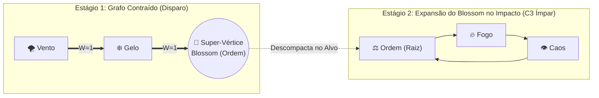
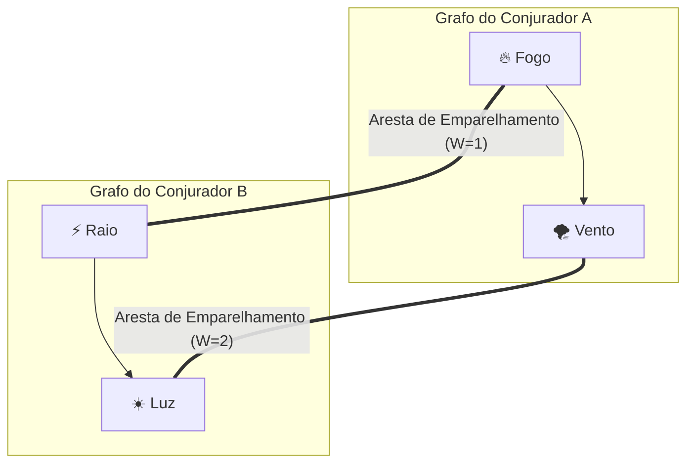
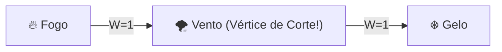

# 🌸 06. Metamagia e Operações Avançadas de Grafo

A **Metamagia Algorítmica** compreende técnicas avançadas estudadas por arquimagos e engenheiros arcanos de Thaluria. Em vez de apenas desenhar grafos estáticos, o conjurador executa transformações topológicas em tempo real — comprimindo ciclos, fundindo malhas de dois conjuradores ou podando arestas para economizar Mana.

---

## 1. Contração de Blossom (Magias em 2 Estágios / Sub-rotinas)

Baseada no *Algoritmo de Emparelhamento de Edmonds*, uma **Flor (Blossom)** é um **ciclo fechado de comprimento ímpar** ($2k + 1$ vértices, como um triângulo de 3 nós ou pentágono de 5 nós) que pode ser **contraído matematicamente em um único Super-Vértice ($V_{\text{Blossom}}$)**.

Na Grafiturgia, isso permite **encapsular um feitiço inteiro dentro de um único vértice de outro feitiço**, criando magias de múltiplos estágios (ex: um projétil perfurante que, após cravar no alvo, descompacta uma explosão ou maldição interna).

### Regras da Contração de Blossom:

1. **Requisito Estrutural:** O feitiço interno encapsulado deve obrigatoriamente formar um **Ciclo Ímpar Válido** (mínimo de 3 vértices fechados em loop). O vértice que se conecta ao grafo externo é chamado de **Haste (Stem/Raiz)** do Blossom, e as conexões externas são calculadas usando o elemento da Haste.
2. **Alívio de Carga Cognitiva (Compressão Mental):**
Enquanto contraído, um Blossom de 3 vértices é processado pelo cérebro como uma unidade compactada, ocupando apenas **2 pontos de Capacidade Mental** (em vez de 3) na checagem de limite:

$$\vert{}V\vert{}_{\text{efetivo}} = \vert{}V\vert{}_{\text{externo}} + (\vert{}V\vert{}_{\text{Blossom}} - 1)$$

3. **Execução em Dois Estágios:**
* **Custo de Mana:** Paga-se a soma dos pesos ($\sum W$) do grafo externo + o $\sum W$ interno do Blossom no ato do disparo.
* **Resolução:** Primeiro resolve-se o efeito da topologia externa (ex: o disparo acerta e perfura a defesa do alvo). No início do turno seguinte da vítima (ou instantaneamente após a perfuração), o Super-Vértice se expande e detona o efeito interno do ciclo diretamente *dentro* do alvo, **ignorando armaduras externas e escudos direcionais**!

---

## 2. Emparelhamento Perfeito (Combo Arcano / Fusão de Conjuradores)

Como dois conjuradores podem combinar seus feitiços no mesmo turno para gerar uma magia cataclísmica? Através de um **Grafo Bipartido com Emparelhamento Perfeito (Perfect Matching)**.

### Regras de Sincronia Bipartida:

1. **Pareamento 1-para-1:** Dois conjuradores com a mesma quantidade de vértices ($\vert{}V_A\vert{} = \vert{}V_B\vert{}$) gastam suas ações em conjunto e traçam **Arestas de Emparelhamento** ligando cada vértice do Mago A a exatamente um vértice exclusivo do Mago B (nenhum vértice pode ficar sem par ou compartilhar par).
2. **Validação de Afinidade:** Nenhuma das arestas de ligação entre os dois grafos pode ter peso $W = \infty$ (Opostos Diretos).
3. **Recompensa do Emparelhamento Perfeito:**
* Os dois feitiços se fundem em uma única manifestação de **Grau Equivalente à Soma dos Graus** (ou Grau $+1$).
* Os dados de impacto de ambos os grafos são somados ($\vert{}V_A\vert{} + \vert{}V_B\vert{}$), mas o **custo total de Mana das arestas de ligação é dividido igualmente** entre os dois conjuradores, sem exigir teste de Sobrecarga Neural individual!

---

## 3. Poda de Kruskal / Árvore Geradora Mínima (MST de Emergência)

Quando um mago projeta um feitiço denso e pesado (com múltiplos ciclos e arestas de peso $W=2$), mas percebe que não possui Mana suficiente ou precisa reduzir a DT de Sobrecarga Mental imediatamente, ele pode aplicar uma **Redução para Árvore Geradora Mínima (Minimum Spanning Tree - MST)**.

* **Como Funciona:** O conjurador corta mentalmente todas as arestas redundantes e de maior peso ($W=2$), mantendo apenas o subconjunto mínimo de arestas ($\vert{}E\vert{} = \vert{}V\vert{} - 1$) que mantém todos os vértices conectados pelo **menor custo possível de $\sum W$**.
* **Efeito Mecânico:**
* O custo de Mana despenca para o mínimo matemático possível.
* O feitiço **mantém 100% dos seus dados base de vértices ($\vert{}V\vert{}$)**, porém perde todos os bônus de Ciclo Fechado, Cordas ou Rigidez de Barreira ($k$), manifestando-se como um **Feixe Ramificado Instável (Árvore)**.

---

## 4. Vértices de Articulação (Cut-Vertices) e Contra-Mágica Tática

Na Grafiturgia, anular a magia de outro mago (*Dispel* / Contra-Mágica) não é uma simples disputa de força bruta — é um ataque cirúrgico à **Conectividade do Grafo ($\kappa$)**.

* **O que é um Vértice de Corte (Articulação):** É qualquer vértice (ou Aresta Ponte) cuja remoção divide o grafo mágico em dois ou mais componentes desconexos.
* *Exemplos Clássicos:* O núcleo central de um **Grafo Estrela**, ou o **Vértice Ponte** que separa dois elementos opostos (`Fogo` $\rightarrow$ `Vento` $\rightarrow$ `Gelo`).

* **Execução da Contra-Mágica Cirúrgica:**
Quando um conjurador inimigo usa sua Reação para lançar uma Contra-Mágica, ele pode mirar especificamente no **Vértice de Corte** do feitiço adversário:
1. **Contra Grafos com Conectividade $\kappa = 1$ (Possuem Vértice de Corte):** O conjurador defensor precisa destruir apenas **1 vértice** (teste de Arcanismo contra a DT da magia). Se tiver sucesso e o vértice destruído for uma **Ponte entre Elementos Opostos**, os polos antagônicos restantes colidem e causam **Inversão de Feitiço** no atacante!
2. **Contra Grafos $k$-Conexos ($\kappa \ge 2$ ou $\kappa \ge 3$, como Ciclos Fechados e Escudos $K_4$):** Como não existem vértices de corte únicos (remover 1 vértice ainda deixa o resto do grafo conectado pelas outras rotas), o feitiço é **Imune a Desarme Simples**! Para cancelar um grafo $K_4$ ($3$-conexo), o inimigo precisaria romper 3 vértices simultaneamente.
