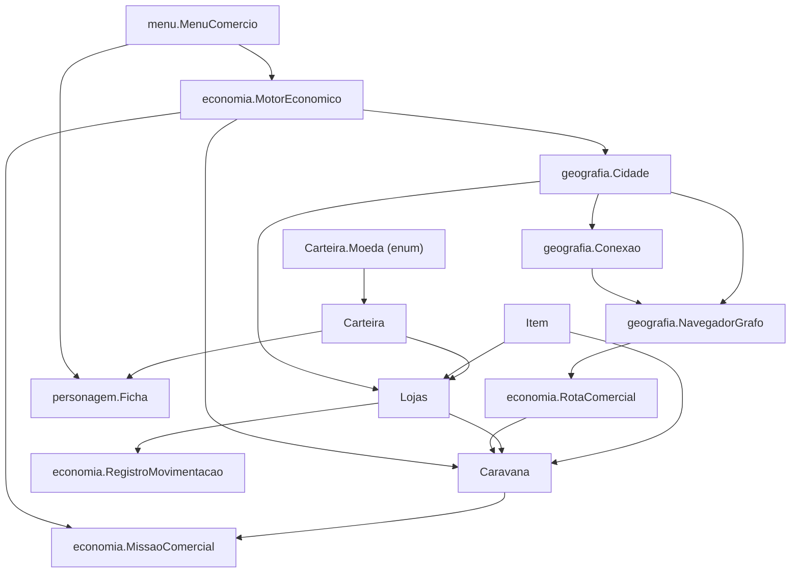

# 💰 Sistema de Vendas e Economia Dinâmica v3 — Thaluria RPG

Este documento é a especificação técnica e canônica de **todo o ecossistema econômico, comercial e geográfico** implementado em Java puro (pacotes `economia`, `geografia`, `personagem` e `menu`).

A **Versão 3 (v3)** unifica a base monetária de **10 moedas calculadas em Latão (`long`)**, a navegação no grafo com **Dijkstra (`NavegadorGrafo`)**, a **precificação dinâmica de oferta e demanda**, os **6 tipos canônicos de estabelecimentos**, as **caravanas com rastreamento físico hora a hora**, o **quadro de missões para jogadores e NPCs**, as **mudanças dinâmicas de perigo nas estradas** e o **livro-caixa contábil com histórico completo**.

---

## 📑 Índice

1. [Visão Geral da Arquitetura](#1--visão-geral-da-arquitetura)
2. [Escala Monetária Canônica (10 Moedas em Latão)](#2--escala-monetária-canônica-10-moedas-em-latão)
3. [Tipos Canônicos de Estabelecimentos Comerciais](#3--tipos-canônicos-de-estabelecimentos-comerciais)
4. [Sistema de Oferta e Demanda (Preços Dinâmicos)](#4--sistema-de-oferta-e-demanda-preços-dinâmicos)
5. [Grafo Territorial e Navegação com Dijkstra](#5--grafo-territorial-e-navegação-com-dijkstra)
6. [Cálculo de Frete, Escoltas e RotaComercial](#6--cálculo-de-frete-escoltas-e-rotacomercial)
7. [Comércio Intermunicipal e Redes Comerciais](#7--comércio-intermunicipal-e-redes-comerciais)
8. [Caravanas Comerciais e Deslocamento Físico](#8--caravanas-comerciais-e-deslocamento-físico)
9. [Extravios de Cargas e Alterações Dinâmicas de Perigo](#9--extravios-de-cargas-e-alterações-dinâmicas-de-perigo)
10. [Quadro de Missões (Escoltas e Resgates)](#10--quadro-de-missões-escoltas-e-resgates)
11. [Livro-Caixa e Auditoria Financeira](#11--livro-caixa-e-auditoria-financeira)
12. [Motor Central de Simulação Econômica](#12--motor-central-de-simulação-econômica)
13. [Menu Interativo de Testes e Demonstração Automática](#13--menu-interativo-de-testes-e-demonstração-automática)
14. [Guia de Execução e Compilação](#14--guia-de-execução-e-compilação)

---

## 1. 🧭 Visão Geral da Arquitetura

O sistema opera com separação estrita de responsabilidades em Java puro, sem dependências externas:



### Mapa de Classes do Repositório:

| Pacote | Classe | Arquivo | Responsabilidade |
|---|---|---|---|
| `economia` | `Carteira` | [`Carteira.java`](../src/economia/Carteira.java) | Gestão do saldo em 10 moedas com base em latão (`long`), normalização e troco |
| `economia` | `Item` | [`Item.java`](../src/economia/Item.java) | Itens, peso, tipo, raridade, preço base em PO e conversão exata para latão |
| `economia` | `Lojas` | [`Lojas.java`](../src/economia/Lojas.java) | Estoque, catálogo conhecido, oferta/demanda, compras de NPCs e livro-caixa |
| `economia` | `RotaComercial` | [`RotaComercial.java`](../src/economia/RotaComercial.java) | Indicadores agregados da rota (distância, perigo ponderado, frete e escolta) |
| `economia` | `RegistroMovimentacao` | [`RegistroMovimentacao.java`](../src/economia/RegistroMovimentacao.java) | Registro imutável de transações e auditoria contábil com timestamp do mundo |
| `economia` | `Caravana` | [`Caravana.java`](../src/economia/Caravana.java) | Rastreamento físico hora a hora nas arestas do grafo e cálculo de risco |
| `economia` | `MissaoComercial` | [`MissaoComercial.java`](../src/economia/MissaoComercial.java) | Contratos de escolta e resgate para jogadores ou resolução via NPCs |
| `economia` | `MotorEconomico` | [`MotorEconomico.java`](../src/economia/MotorEconomico.java) | Relógio mundial, ciclo diário, expedição autônoma e ajuste dinâmico de perigo |
| `geografia` | `Cidade` | [`Cidade.java`](../src/geografia/Cidade.java) | Vértices do grafo territorial, biomas, infraestrutura portuária e sedes de lojas |
| `geografia` | `Conexao` | [`Conexao.java`](../src/geografia/Conexao.java) | Arestas do grafo (distância km, perigo 1-10, modalidade terrestre/marítima) |
| `geografia` | `NavegadorGrafo` | [`NavegadorGrafo.java`](../src/geografia/NavegadorGrafo.java) | Algoritmo de Dijkstra que encontra o trajeto ótimo ponderando risco e distância |
| `personagem`| `Ficha` | [`Ficha.java`](../src/personagem/Ficha.java) | Status de aventureiro, inventário pessoal e carteira de 10 moedas |
| `menu` | `MenuComercio` | [`MenuComercio.java`](../src/menu/MenuComercio.java) | Interface de console completa com 12 opções e quick demo automatizado |
| `menu` | `CenarioInicial` | [`CenarioInicial.java`](../src/menu/CenarioInicial.java) | Construtor do cenário canônico de Thaluria com 5 cidades e lojas |
| *(raiz)* | `Main` | [`Main.java`](../src/Main.java) | Ponto de entrada executável direto |

---

## 2. 🪙 Escala Monetária Canônica (10 Moedas em Latão)

Para eliminar qualquer erro de ponto flutuante (`double`), todas as transações, fretes, recompensas e preços dinâmicos são calculados internamente em **Latão (`long`)**, a menor unidade da economia.

### 2.1. Regra de Conversão

```
1 Édito    = 1000 Talentos  (Única exceção de proporção 1000:1)
1 Talento  = 10 Diamantes
1 Diamante = 10 Cobaltos
1 Cobalto  = 10 Platinas
1 Platina  = 10 Ouros
1 Ouro     = 10 Pratas
1 Prata    = 10 Cobres
1 Cobre    = 10 Ferros
1 Ferro    = 10 Latões
```

### 2.2. Tabela de Moedas (`Carteira.Moeda`)

| Moeda | Constante | Sigla | Valor em Latão (`long`) | Valor em Ouro (PO) |
|---|---|:---:|---:|---:|
| **Latão** | `LATAO` | `PL` | **1** | 0,0001 |
| **Ferro** | `FERRO` | `PF` | **10** | 0,001 |
| **Cobre** | `COBRE` | `PC` | **100** | 0,01 |
| **Prata** | `PRATA` | `PP` | **1.000** | 0,1 |
| **Ouro** | `OURO` | **`PO`** | **10.000** | **1,0** |
| **Platina** | `PLATINA` | `PT` | **100.000** | 10,0 |
| **Cobalto** | `COBALTO` | `CB` | **1.000.000** | 100,0 |
| **Diamante** | `DIAMANTE` | `DI` | **10.000.000** | 1.000,0 |
| **Talento** | `TALENTO` | `TL` | **100.000.000** | 10.000,0 |
| **Édito** | `EDITO` | `ED` | **100.000.000.000** | 10.000.000,0 |

> [!NOTE]
> A carteira normaliza automaticamente qualquer valor adicionado ou debitado, organizando os fundos sempre da maior denominação para a menor. Exemplo: `1.234.567 latão` é exibido como:
> `1 CB, 2 PT, 3 PO, 4 PP, 5 PC, 6 PF, 7 PL`.

---

## 3. 🏬 Tipos Canônicos de Estabelecimentos Comerciais

Na v3, os estabelecimentos comerciais (`Lojas.TipoEstabelecimento`) foram padronizados exclusivamente nas **6 categorias econômicas** do universo de Thaluria:

```java
public enum TipoEstabelecimento {
    FORJA("Forja / Ferraria"),
    ALFAIATARIA("Alfaiataria / Tecelagem"),
    LOJA_GERAL("Loja Geral / Empório"),
    ALQUIMIA("Alquimia / Botica"),
    JOALHERIA("Joalheria"),
    TAVERNA("Taverna / Comidas e Bebidas");
}
```

### Especialização dos Comércios:

1. **Forja (`FORJA`)**:
   * *Mercadorias:* Lingotes metálicos (ferro, aço), armas brancas, armaduras de placas e escudos.
   * *Comportamento:* Demanda elevada por minérios brutos e combustível.
2. **Alfaiataria (`ALFAIATARIA`)**:
   * *Mercadorias:* Mantos de viagem, sedas nobres, túnicas reforçadas, armaduras leves de couro e tecido.
   * *Comportamento:* Compra fibras e peles de caçadores locais.
3. **Loja Geral (`LOJA_GERAL`)**:
   * *Mercadorias:* Artigos sortidos, ferramentas de exploração, tochas, cordas e mercadorias de importação.
   * *Comportamento:* Frequentemente associada a redes comerciais (`lojaDeRede = true`).
4. **Alquimia (`ALQUIMIA`)**:
   * *Mercadorias:* Poções de cura, elixires de mana, reagentes e pós mágicos.
   * *Comportamento:* Compra ervas raras e extratos alquímicos de aventureiros e coletores.
5. **Joalheria (`JOALHERIA`)**:
   * *Mercadorias:* Gemas polidas das areias, anéis encantados, amuletos e metais preciosos.
   * *Comportamento:* Caixa elevado e movimentações de alto valor agregado em platina e cobalto.
6. **Taverna (`TAVERNA`)**:
   * *Mercadorias:* Comidas, rações de viagem nutritivas, hidromel das montanhas, cervejas e suprimentos perecíveis.
   * *Comportamento:* Ponto de encontro de viajantes e alta rotação diária de consumíveis de baixo a médio custo.

---

## 4. 📈 Sistema de Oferta e Demanda (Preços Dinâmicos)

O preço unitário de venda e o preço de compra de fornecedores NPCs reagem organicamente à escassez, às entradas/saídas recentes e à demanda acumulada.

### 4.1. Fórmulas Matemáticas

$$\text{Pressão de Demanda} = \text{Demanda} + (\text{Saídas Recentes} \times 0.5) + 1.0$$

$$\text{Pressão de Oferta} = \text{Estoque Atual} + (\text{Entradas Recentes} \times 0.3) + 1.0$$

$$\text{Multiplicador} = \sqrt{\frac{\text{Pressão de Demanda}}{\text{Pressão de Oferta}}}$$

$$\text{Multiplicador Clamped} = \max(0.40, \; \min(2.50, \; \text{Multiplicador}))$$

$$\text{Preço de Venda Dinâmico (Latão)} = \max(1\text{L}, \; \text{round}(\text{Preço Base em Latão} \times \text{Multiplicador Clamped}))$$

$$\text{Preço de Compra NPC (Latão)} = \max(1\text{L}, \; \text{round}(\text{Preço de Venda Dinâmico} \times 0.65))$$

### 4.2. Comportamento Econômico

* **Saturação de Mercado (Estoque alto, pouca procura):** O preço pode cair até **40% do valor base** (liquidação de excessos).
* **Escassez Severa (Estoque zerado, procura alta):** O preço pode subir até **250% do valor base** (alta de escassez).
* **Margem de Lucro da Loja:** A loja sempre compra de NPCs a **65% do valor dinâmico atual de venda**, garantindo uma margem bruta de 35% nas operações locais.
* **Decaimento Diário:** No início de cada novo dia, `loja.decairFluxoRecente()` divide entradas e saídas recentes por 2, permitindo que os preços voltem gradativamente ao equilíbrio.

---

## 5. 🗺️ Grafo Territorial e Navegação com Dijkstra

A geografia de Thaluria é modelada como um **Grafo Ponderado Bidirecional**:
* **Vértices ($V$):** Cidades ([`Cidade.java`](../src/geografia/Cidade.java)).
* **Arestas ($E$):** Conexões ([`Conexao.java`](../src/geografia/Conexao.java)).

### 5.1. O Algoritmo de Dijkstra (`NavegadorGrafo`)

O método `NavegadorGrafo.calcularMelhorRota(origem, destino, pesoPerigo)` encontra o caminho ótimo avaliando custo composto:

$$\text{Custo da Aresta} = \text{Distância (km)} \times (1.0 + (\text{Perigo} \times \text{pesoPerigo}))$$

* **Peso de Perigo Padrão:** `0.25` (cada nível de perigo encarece a função de custo em 25%).
* **Rotas Bloqueadas:** Conexões com `conexao.isBloqueada() == true` são imediatamente descartadas pela busca, forçando o desvio por caminhos alternativos.
* **Retorno:** Instancia e devolve uma [`RotaComercial`](../src/economia/RotaComercial.java) contendo a lista ordenada de cidades e arestas do trajeto.

---

## 6. 🚚 Cálculo de Frete, Escoltas e RotaComercial

A classe [`RotaComercial`](../src/economia/RotaComercial.java) agrega os indicadores da rota no momento da sua instanciação:

* **Distância Total:** Soma das distâncias de todas as conexões em km.
* **Perigo Médio Ponderado:** Média ponderada pela distância de cada trecho:
  $$\text{Perigo Médio} = \frac{\sum (\text{Perigo}_i \times \text{Distância}_i)}{\text{Distância Total}}$$
* **Perigo Máximo:** O maior nível de perigo individual (pico de risco do percurso).

### 6.1. Custos em Latão (`long`)

* **Frete (Transporte da Carga):**
  $$\text{Frete} = \text{round}\left( \text{Distância Total} \times 200 \times \left(1 + \frac{\text{Peso (kg)}}{50}\right) \times (1 + \text{Perigo Médio} \times 0.15) \right)$$
  *(Base: 2 PC / 200 latão por km).*
* **Escolta Armada:**
  $$\text{Escolta} = \text{round}( \text{Distância Total} \times 500 \times (1 + \text{Perigo Médio} \times 0.25) )$$
  *(Base: 5 PC / 500 latão por km).*
* **Recomendação de Escolta:**
  Retorna `true` se $\text{Perigo Médio} \ge 4.0$ **ou** $\text{Perigo Máximo} \ge 6$.

---

## 7. 🤝 Comércio Intermunicipal e Redes Comerciais

Quando uma loja sofre déficit de estoque frente à demanda projetada (`getDeficitDemanda(id) > 0`), o `MotorEconomico` executa a compra autônoma entre assentamentos:

1. **Varredura no Grafo:** O motor busca todas as cidades que possuem lojas com estoque suficiente da mercadoria.
2. **Cálculo da Rota Ótima:** Para cada candidata, invoca o `NavegadorGrafo` para estimar frete e perigo.
3. **Desconto de Rede Comercial:** Se compradora e fornecedora pertencerem à mesma rede comercial (ex.: *"Liga Mercantil do Norte"*), a mercadoria recebe **25% de desconto** no preço unitário.
4. **Seleção da Melhor Opção:** Escolhe o fornecedor cujo custo total ($\text{Custo Mercadorias} + \text{Frete}$) seja o menor possível.
5. **Transação Financeira:**
   * A compradora paga a mercadoria para a fornecedora (`caixa.pagarLatao`).
   * A compradora paga o frete via `rota.pagarFrete(caixa, pesoTotal)`.
   * As unidades são subtraídas do estoque da fornecedora e ambas registram a movimentação no livro-caixa.
6. **Expedição:** Instancia a `Caravana` e avalia se há necessidade de escolta armada.

---

## 8. 🐎 Caravanas Comerciais e Deslocamento Físico

A classe [`Caravana`](../src/economia/Caravana.java) modela a expedição física que se move pela malha viária:

### 8.1. Estados da Caravana (`StatusCaravana`)

* `AGUARDANDO_ESCOLTA`: Aguardando resposta do quadro de avisos no porto/cidade de origem.
* `EM_TRANSITO`: Deslocando-se quilômetro a quilômetro pelas arestas.
* `EXTRAVIADA`: Carga interceptada e emboscada por saqueadores/monstros no grafo.
* `ENTREGUE`: Carga descarregada com sucesso no armazém da loja de destino.
* `PERDIDA_DEFINITIVAMENTE`: Missão de resgate fracassou e a carga foi consumida ou pilhada.

### 8.2. Cinemática e Velocidade

* **Rotas Terrestres:** Velocidade de **6,0 km/h**.
* **Rotas Marítimas:** Velocidade de **14,0 km/h** (exigem portos ativos em ambas as cidades).

### 8.3. Segurança e Níveis de Proteção (`TipoProtecao`)

| Proteção | Comportamento de Risco | Taxa de Segurança |
|---|---|:---:|
| **`ESCOLTADA_JOGADOR`** | Assumida por aventureiros no quadro de avisos | **100% Segurança (Sem emboscadas)** |
| **`ESCOLTADA_NPC`** | Mercenários locais contratados pela loja | **Risco horário reduzido em 75%** |
| **`DESPROTEGIDA`** | Segue sem proteção armada | Risco pleno baseado no perigo da aresta |

---

## 9. ⚔️ Extravios de Cargas e Alterações Dinâmicas de Perigo

Se uma caravana desprotegida ou sob escolta de NPCs falhar no teste de risco de uma aresta perigosa:

1. **Congelamento Geográfico:** O status muda para `EXTRAVIADA`. O sistema registra com exatidão:
   * A aresta onde o ataque ocorreu (ex.: `[Ironhold <-> Valdorian]`);
   * O quilômetro exato da estrada (ex.: `no Km 54,0 / 80km`);
   * O dia e hora exatos do mundo.
2. **Geração da Missão de Resgate:** Cria uma `MissaoComercial` do tipo `RESGATE_CARGA` sediada na cidade mais próxima do incidente, com **prazo de 24 horas** e recompensa de **35% do valor total da carga** (mínimo de 10.000 latão / 1 PO).
3. **Resolução Dinâmica do Perigo:**
   * **Se o Jogador ou Milícia NPC resgatar com sucesso:**
     * A carga é recuperada e entregue ao destino.
     * O perigo da aresta é reduzido: `conexao.ajustarPerigo(-1)`.
   * **Se o prazo expirar e os NPCs fracassarem:**
     * A carga é perdida definitivamente.
     * Os saqueadores dominam a área e o perigo aumenta: `conexao.ajustarPerigo(+1)`.

> [!IMPORTANT]
> **O grafo se adapta ao histórico do jogo!** Se uma estrada sofrer múltiplos ataques sem resgate, seu perigo subirá (ex.: de 4 para 7), encarecendo fretes futuros e fazendo com que o algoritmo de Dijkstra desvie novas caravanas por outras regiões.

---

## 10. 🛡️ Quadro de Missões (Escoltas e Resgates)

A classe [`MissaoComercial`](../src/economia/MissaoComercial.java) gerencia as oportunidades disponibilizadas aos jogadores:

### 10.1. Tipos de Missão

* **`ESCOLTA`**: Prazo de **12 horas**. O jogador acompanha a caravana garantindo 100% de segurança física até o destino. A recompensa é o valor integral da escolta calculada pela rota.
* **`RESGATE_CARGA`**: Prazo de **24 horas**. O jogador viaja até a coordenada da aresta emboscada, vence os saqueadores e recupera o lote extraviado.

### 10.2. Expiração de Prazos

Se nenhum jogador aceitar a missão dentro do prazo:
* **Escolta:** O sistema realiza uma checagem (60% de chance de NPCs mercenários estarem disponíveis no bar local). Se a loja tiver fundos, contrata escolta NPC; caso contrário, a caravana parte desprotegida.
* **Resgate:** Uma patrulha de NPCs tenta uma incursão proporcional ao perigo da rota ($\text{Chance} = \max(15\%, \; 65\% - (\text{Perigo} \times 5\%))$).

---

## 11. 📜 Livro-Caixa e Auditoria Financeira

Todas as operações comerciais são registradas no histórico contábil da loja ([`RegistroMovimentacao`](../src/economia/RegistroMovimentacao.java)), permitindo auditoria completa:

### Exemplo de Extrato Contábil Formatado:

```text
[Dia 1, 08h] Venda no Balcão              | Lingote de Ferro (x1) | Valor: 2 PO, 7 PP, 2 PC, 9 PF, 8 PL | Caixa: 1 CB, 5 PT, 2 PO, 7 PP, 2 PC, 9 PF, 8 PL | Venda balcão para cliente
[Dia 1, 08h] Despesa com Frete            | Lingote de Ferro (x5) | Valor: 7 PO, 5 PP, 6 PC             | Caixa: 7 PT, 2 PO, 4 PP, 4 PC                   | Encomenda + Frete de Armazém Central da Rede
[Dia 1, 17h] Extravio de Carga            | Lingote de Ferro (x5) | Valor: 0 PO                         | Caixa: 7 PT, 2 PO, 4 PP, 4 PC                   | Extraviada em [Valdorian <-> Ironhold] no Km 54,0/80km
[Dia 2, 09h] Carga Recuperada             | Lingote de Ferro (x5) | Valor: 0 PO                         | Caixa: 7 PT, 2 PO, 4 PP, 4 PC                   | Carga recuperada por milícia local de NPCs
```

---

## 12. ⚙️ Motor Central de Simulação Econômica

O [`MotorEconomico`](../src/economia/MotorEconomico.java) é o regente de todas as regras vivas do mundo:

```java
// Avança o relógio mundial hora a hora
motor.avancarTempo(horas);
```

A cada avanço:
1. Avança os relógios (`horaAtual`, `diaAtual`).
2. Se o dia virar (`horaAtual == 0`), dispara `executarCicloDiario()`:
   * Decai fluxos recentes de compras e vendas;
   * Fornecedores NPCs locais abastecem comércios (35% de chance);
   * Demandas oscilam organicamente;
   * Lojas com déficit geram encomendas intermunicipais automáticas.
3. Processa caravanas em trânsito (avanço em quilômetros, testes de emboscada e entregas).
4. Reduz prazos de missões pendentes nos quadros de avisos municipais.

---

## 13. 🎮 Menu Interativo de Testes e Demonstração Automática

O console interativo em [`src/menu/MenuComercio.java`](../src/menu/MenuComercio.java) fornece controle manual e visualização de cada engrenagem do sistema:

### As 12 Opções do Menu:

1. **Visualizar Mapa e Grafo Territorial:** Exibe todas as cidades, portos, biomas, distâncias em km, nível de perigo (1 a 10) e status de bloqueio.
2. **Consultar Lojas, Especializações e Estoques:** Mostra forjas, alfaiatarias, lojas gerais, alquimias, joalherias e tavernas com saldo em moedas e preços em tempo real.
3. **Simular Oferta e Demanda:** Permite testar a fórmula matemática, alterando a demanda ou o estoque de qualquer item e assistindo à flutuação de preços.
4. **Comércio no Balcão com Jogador:** Permite ao jogador comprar itens da loja (pagando em latão com troco automático) ou vender itens do inventário.
5. **Simular Fornecedor NPC Local:** Força a chegada de caçadores ou mineradores vendendo lotes de matéria-prima a 65% do preço dinâmico.
6. **Simular Comércio Intermunicipal & Rota Dijkstra:** Seleciona loja compradora e dispara o algoritmo de Dijkstra, aplicando descontos de rede e frete.
7. **Quadro de Missões:** Exibe os contratos de escolta armada e resgates de carga. Permite que o jogador aceite e receba o pagamento na carteira.
8. **Avançar Tempo do Mundo:** Salta 1h, 6h, 12h, 24h ou horas personalizadas, acompanhando o deslocamento das caravanas.
9. **Gerenciar Perigo e Bloqueio de Estradas:** Permite subir/descer o perigo manualmente ou bloquear uma ponte/estrada para forçar o Dijkstra a desviar.
10. **Livro-Caixa e Histórico Contábil:** Emite o extrato financeiro completo de qualquer estabelecimento nas 10 moedas.
11. **Ficha, Carteira e Inventário do Jogador:** Exibe a ficha canônica de atributos (Status.md), permite viagem entre cidades ou adição de ouro de teste.
12. **Executar Demonstração Automatizada Completa:** Bateria de testes passo a passo em 1 clique que valida os 6 pilares do sistema com logs explicativos.

---

## 14. 🛠️ Guia de Execução e Compilação

### Compilação Limpa no Windows / Linux / macOS:

```powershell
# Compilar todas as classes para o diretório bin/
javac -d bin -sourcepath src src/Main.java src/menu/*.java src/economia/*.java src/geografia/*.java src/personagem/*.java src/teste/*.java
```

### Executar o Sistema:

```powershell
# 1. Execução do Menu Interativo Completo
java -cp bin Main

# 2. Execução da Suite de Testes End-to-End (E2E) Automatizada
java -cp bin Main --test
# Ou diretamente:
java -cp bin teste.TesteEndToEnd
```

---

## 15. 🧪 Suite de Testes End-to-End (`src/teste/TesteEndToEnd.java`)

O sistema possui uma bateria automatizada de testes cobrindo **100% dos fluxos e regras econômico-geográficas** (69 asserções validadas com 100% de sucesso):

1. **Teste 1 — Escala Monetária:** Decomposição exata de 1.234.567 latão, conversão ouro-latão sem resíduos e troco automático.
2. **Teste 2 — Estabelecimentos Canônicos:** Validação dos 6 tipos (`FORJA`, `ALFAIATARIA`, `LOJA_GERAL`, `ALQUIMIA`, `JOALHERIA`, `TAVERNA`) e vínculo bidirecional com cidades.
3. **Teste 3 — Oferta e Demanda:** Reação dinâmica de preços a choques de escassez (teto 250%) e excesso (piso 40%), além do preço de compra NPC (65%).
4. **Teste 4 — Comércio de Balcão:** Compra e venda de aventureiros no balcão com débito/crédito direto nas carteiras e alteração de estoques.
5. **Teste 5 — Fornecedor NPC Local & Produção Regional:** Compra de lote por loja com dedução de capital de giro, registro `ENTRADA_NPC` e validação da afinidade de insumos por Bioma e Geologia (Montanha gera minérios, Floresta gera madeiras).
6. **Teste 6 — Grafo e Dijkstra:** Seleção do trajeto mais seguro pelo algoritmo de Dijkstra e recálculo dinâmico quando estradas são bloqueadas.
7. **Teste 7 — Comércio Intermunicipal e Rede:** Compra automatizada entre cidades, frete pago e aplicação de **25% de desconto de rede**.
8. **Teste 8 — Escolta por Jogador:** Contrato aceito com 100% de segurança, **lastro financeiro com débito direto no caixa da loja contratante**, registro de `DESPESA_ESCOLTA` e **deslocamento físico automático do aventureiro** para a cidade destino.
9. **Teste 9 — Extravio e Resgate:** Caravana emboscada, posição física rastreada, resgate concluído com **débito legítimo no caixa da loja contratante** e **pacificação da estrada (-1 de perigo)**.
10. **Teste 10 — Fracasso de Resgate:** Perda definitiva da carga e **escalada de perigo na estrada (+1 de perigo)**.
11. **Teste 11 — Auditoria do Livro-Caixa:** Rastreamento contábil com timestamps `[Dia X, Yh]`, itens, valores e saldos consistentes.

---

## 16. 💎 Lapidação dos Comportamentos de Borda da Etapa 1 (Pré-Crafting)

A v3 foi lapidada e blindada em três pontos cruciais de integridade do mundo:

### 16.1. Lastro Financeiro Absoluto em Escoltas e Resgates
* **Regra de Ouro:** Nenhuma moeda é gerada do nada.
* Quando o jogador conclui uma missão de `ESCOLTA` ou `RESGATE_CARGA`, o pagamento é **debitado do caixa da loja contratante** (`caravanaAlvo.getLojaDestino().getCaixa().pagarLatao(...)`) antes de ingressar na `Carteira` do jogador.
* A loja contratante registra a operação contábil `DESPESA_ESCOLTA` em seu Livro-Caixa (`RegistroMovimentacao`), mantendo a integridade monetária da economia.
* A encomenda intermunicipal agora também verifica antecipadamente a reserva de fundos para a escolta quando a rota for perigosa.

### 16.2. Deslocamento Geográfico do Jogador (`Ficha.cidadeAtual`)
* O jogador possui vínculo de localização física no mundo (`Ficha.getCidadeAtual()` e `setCidadeAtual(Cidade)`).
* O quadro de missões (`listarMissoesDisponiveis(Cidade)`) permite filtrar contratos locais da cidade de partida (Requisito 4).
* Ao aceitar e escoltar uma caravana da Cidade A até a Cidade B, na chegada da caravana ao destino, a localização do jogador é **automaticamente atualizada para a Cidade B**, simulando a viagem real pelo continente.

### 16.3. Produção Regional de Matéria-Prima por Bioma e Geologia (Ponte para o Crafting)
* As cidades possuem atributos de `Regiao` (bioma climático), `Geologia` (relevo) e `Aquifero`.
* O método `Cidade.calcularChanceFornecedorNpc(Item)` calcula a chance diária de abastecimento orgânico por afinidade ambiental:
  * **Montanha / Caverna (`Geologia.MONTANHA`, `CAVERNA`):** Alta produção de minérios, ferro bruto, lingotes e gemas (65% de chance diária, lotes ampliados de 2 a 5 unidades). Madeira é escassa (15%).
  * **Floresta / Taiga / Tundra (`Geologia.FLORESTA`, `Regiao.TAIGA`, `Regiao.TUNDRA`):** Alta produção de madeiras nobres, peles e couros (70% de chance diária). Minérios são escassos (20%).
  * **Planície / Vale / Temperado (`Geologia.PLANICIE`, `VALE`):** Alta colheita de ervas alquímicas, linho, fibras e seda de Valdorian (65% de chance).
  * **Deserto / Canyon (`Regiao.DESERTO`, `Geologia.CANYON`):** Alta incidência de gemas preciosas, cristais das areias e joias (75% de chance).
* Essa lógica no `executarCicloDiario()` cria o ecossistema perfeito para que cidades com escassez de um recurso precisem criar caravanas comerciais para importar insumos de cidades abundantes — alimentando o futuro sistema de **Crafting**.

