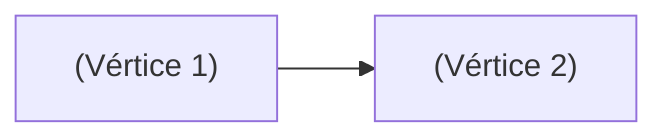

# 📜 REGISTRO DE MAGIA: (NOME DO FEITIÇO)
*"(Frase de encantamento, fórmula hermética ou descrição poética da manifestação)"*

---

## 1. DADOS DE IDENTIFICAÇÃO E CONJURAÇÃO
- **Conjurador / Criador:** (Nome do Personagem ou Tradição Arcana)
- **Grau Pretendido ($G_{\text{magia}}$):** Grau 1 | Grau 2 | Grau 3 | Outro: _____
- **Tempo de Execução:** ( ) 1 Ação Padrão | ( ) Ação Bônus | ( ) Reação | ( ) Ritual (10 min+)
- **Alcance / Área:** (Ex: Toque / Projétil 15m / Raio de 4m ao redor do ponto de impacto)
- **Duração:** ( ) Instantâneo | ( ) Sustentado (X turnos com concentração) | ( ) Permanente

---

## 2. ESTRUTURA DO GRAFO ARCANO

### 🔹 Vértices Elementais ($|V|$)
- **Quantidade Total de Vértices ($|V|$):** ____
- **Elementos Utilizados:**
  1. (Ex: 🔥 Fogo)
  2. (Ex: 🌪️ Vento)
  3. (Ex: ⚡ Raio)
- **Checagem de Limite Mental:**
  * Grau de Mental do Conjurador ($G_{\text{MEN}}$): _____
  * Limite Estável ($2 + G_{\text{MEN}}$): _____
  * **Status:** ( ) Estável ($|V| \le 2 + G_{\text{MEN}}$) | ( ) Sobrecarga (Requer teste de Ocultismo/Arcanismo DT: _____)

---

### 🔹 Topologia e Geometria
- **Intenção Tática:** ( ) Disparo / Projétil | ( ) Explosão / Área (AoE) | ( ) Barreira / Escudo | ( ) Maldição / Controle
- **Formato do Grafo:**
  * ( ) **Caminho Hamiltoniano** (Linha sequencial aberta sem repetição)
  * ( ) **Ciclo Hamiltoniano Fechado** (Concede bônus de $+5 \times G_{\text{magia}}$ no dano)
  * ( ) **Grafo Estrela** (Núcleo focal + nós satélites)
  * ( ) **Grafo Regular / Simétrico** (Polígono regular equilibrado $K_n$)
  * ( ) **Árvore / Ciclo com Ordem** (Estrutura ramificada persistente)

---

### 🔹 Arestas, Conexões e Pesos ($\sum W$)
*(Liste cada par de vértices interligados e seu respectivo peso conforme a Matriz Elemental)*
- **Aresta 1:** `(Elemento A)` $\rightarrow$ `(Elemento B)` | Peso $W = $ (1 Harmônico / 2 Neutro)
- **Aresta 2:** `(Elemento B)` $\rightarrow$ `(Elemento C)` | Peso $W = $ (1 Harmônico / 2 Neutro)
- **Aresta 3:** `(Elemento ...)` $\rightarrow$ `(Elemento ...)` | Peso $W = $ (1 Harmônico / 2 Neutro)
- **Soma Total dos Pesos ($\sum W$):** _____
- **Verificação de Antagonismo:** ( ) Nenhuma ligação proibida direta sem Vértice Ponte.

---

## 3. CÁLCULO DE CUSTOS E IMPACTO

- **Custo de Mana:**
  $$\text{Custo} = \left(\sum W\right) \times 2 \times G_{\text{magia}} = \mathbf{\_\_\_\_\_ \text{ Mana}}$$
- **Dados de Dano / Efeito Base:**
  $$D = |V| \text{ dados} = \mathbf{\_\_\_\_\_d\_\_\_\_}$$
- **Alvo do Dano:** ( ) HP (Físico/Elemental) | ( ) SAN (Psíquico/Caos) | ( ) Híbrido (Dividido)

---

## 4. ESQUEMA VISUAL DO GRAFO
*(Desenhe o grafo usando sintaxe Mermaid ou diagrama textual)*

---

## 5. VEREDITO DO MESTRE & EFEITOS TÁTICOS
- **Descrição Narrativa:** (Como a magia se manifesta visualmente e sonoramente no ambiente).
- **Condições Especiais:** (Ex: Queimadura, Cegueira, Empurrão X metros, Lentidão, Paralisia, Terreno Difícil).
